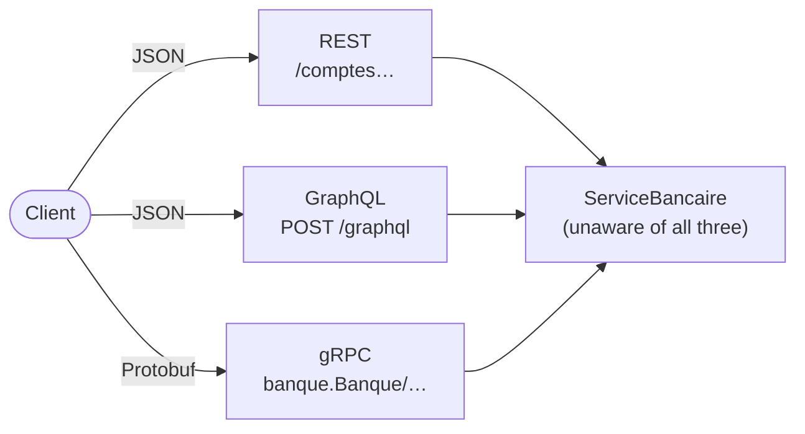

# Cheat sheet 23 · REST, gRPC, GraphQL

> **In one sentence**: the same business logic exposed as **resources** (REST), as **procedures** (gRPC) and as a
> **graph the client queries** (GraphQL).

**Family**: exposure · **Demo**: [`23-RestGrpcGraphQL`](../../../23-RestGrpcGraphQL) (REST and GraphQL 5123 over
HTTP/1.1, gRPC 5250 over HTTP/2; Protobuf, gRPC and GraphQL hand-written) · 📖 [Full page (French)](../../23-rest-grpc-graphql.md) ·
🌐 [Français](../../fiches/23-rest-grpc-graphql.md)

## Key points

| | **REST** | **gRPC** | **GraphQL** |
|---|---|---|---|
| You manipulate | resources + HTTP verbs | procedures | a graph of types |
| Contract | implicit or OpenAPI | `.proto`, generated code | SDL schema, validated before execution |
| Response shape | chosen by the server | chosen by the server | **chosen by the client** |
| Format / transport | JSON, any HTTP | binary, **HTTP/2** required | JSON, `POST` |
| Errors | HTTP status + `problem+json` | gRPC status in the trailers | `200` + `errors` |
| HTTP cache · streaming · browser | ✅ · ❌ · ✅ | ❌ · ✅ · ❌ (gRPC-Web) | ❌ · subscriptions · ✅ |

## When to choose what

- **REST**: public or partner API, simple resources, caching.
- **gRPC**: between internal services; throughput, latency, streaming, strict contracts between teams.
- **GraphQL**: many clients with rich screens; one round trip per screen, instead of one [BFF](16-bff.md) per application.

**Pitfalls**: REST → round trips and over-fetching; gRPC → unreadable without tooling, no browser;
GraphQL → **hidden N+1** (DataLoader), queries to **bound** (depth, cost), HTTP cache lost.

**Takeaway**: the style is chosen **boundary by boundary**; the three often coexist.

---
⬅️ [Strangler Fig](22-strangler-fig.md) · [Cheat sheet index](README.md) · ➡️ [MVC and MVVM](24-mvc-mvvm.md)
