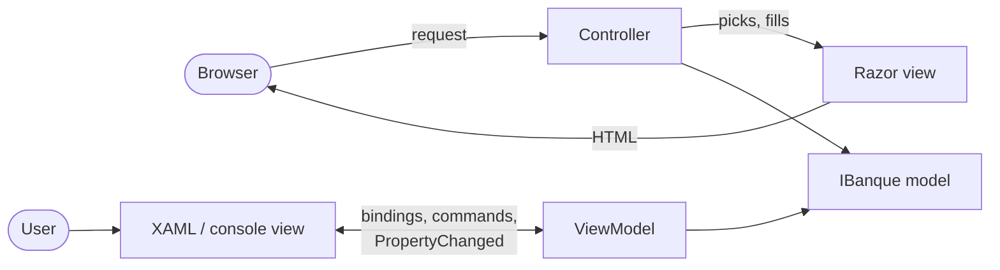

# Cheat sheet 24 · MVC and MVVM

> **In one sentence**: the same screen in web **MVC** (a controller receives the request and picks a view, discarded
> after rendering) and in **MVVM** (a living ViewModel that the view observes through bindings).

**Family**: presentation · **Demo**: [`24-MvcMvvm`](../../../24-MvcMvvm) (MVC site 5124; WPF views, Windows only,
and a console on the same ViewModels) · 📖 [Full page](../24-mvc-mvvm.md) ·
🌐 [Français](../../fiches/24-mvc-mvvm.md)

## Key points

| | **MVC** | **MVVM** |
|---|---|---|
| Receives the action | the controller | the view, which passes it on via a binding or a command |
| Who knows whom | the controller picks the view | the view knows the ViewModel, **not the other way around** |
| Screen lifetime | **one request** | **as long as the window is open** |
| Validation | after submission (ModelState) | **on every keystroke** |
| Testable without a screen | the controller's decision | **all of the screen's behavior** |

- The model knows nothing about screens (architecture test); the ViewModels know nothing about WPF (another test).
- XAML bindings are not compiled: a test **reads the XAML** to check them.
- Vocabulary trap: ASP.NET MVC "view models" are plain data bags, not MVVM ViewModels.

| ✅ MVC | ✅ MVVM |
|---|---|
| Server-rendered site, SEO, holding up under load | Desktop (WPF, WinUI, Avalonia), mobile (MAUI) |

**Pitfalls**: MVC → one page per step, state in hidden fields. MVVM → leaking subscriptions, **stale asynchronous
responses**, the UI thread, ceremony (CommunityToolkit.Mvvm helps).

**Takeaway**: MVC and MVVM are only the **presentation layer**; the model behind them follows any other cheat sheet.

---
⬅️ [REST, gRPC, GraphQL](23-rest-grpc-graphql.md) · [Cheat sheet index](README.md)
