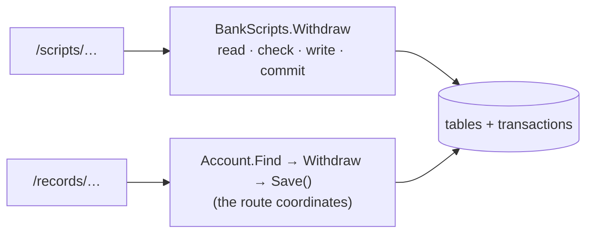

# Cheat sheet 25 · Transaction Script and Active Record

> **In one sentence**: the business written without any architecture: **one procedure per use case**, which reads and
> writes the rows itself, or **one object per table row**, which carries its rules and saves itself.

**Family**: modeling (the starting point) · **Origin**: Martin Fowler, *Patterns of Enterprise Application
Architecture*, 2002; Active Record made popular by Ruby on Rails (2004) ·
**Demo**: [`25-TransactionScriptActiveRecord`](../../../25-TransactionScriptActiveRecord) (port 5125) · 📖 [Full page](../25-transaction-script-active-record.md) ·
🌐 [Français](../../fiches/25-transaction-script-active-record.md)

## Key points

- **Transaction Script**: one method per use case, read from top to bottom; the rows are only data.
- **One transaction = one script**: all or nothing (rollback if the script throws), one at a time.
- **Active Record**: the object wraps its row, loads itself (`Find`), carries its rules (written **once**) and writes
  itself (`Save`, `INSERT` or `UPDATE`).
- No layer between the code and the database: the business **depends on the database** (the opposite of Onion).

| ✅ When to use it | ❌ Less suited if |
|---|---|
| Thin business: CRUD, back office, internal tools, imports | Rich rules that cross from one use case to another |
| Prototype, application that will stay small; Active Record if the objects look like the tables | Database schema far from the model; rules to test without a database |

**Traps**: rules **copied** from one script to the next; **forgotten** `Save` (the change is lost); coordination piling
up in the routes; rule tests that need a database.

**Takeaway**: you leave it at the first symptom, and the symptom says where to: copied rules → [DDD](11-ddd.md);
fat routes → [Layered](00-couches.md), [Clean](03-clean.md); tests that need a database →
[Hexagonal](01-hexagonale.md); independent scripts → [Vertical Slice](05-vertical-slice.md).

---
⬅️ [MVC and MVVM](24-mvc-mvvm.md) · [Cheat sheet index](README.md)
