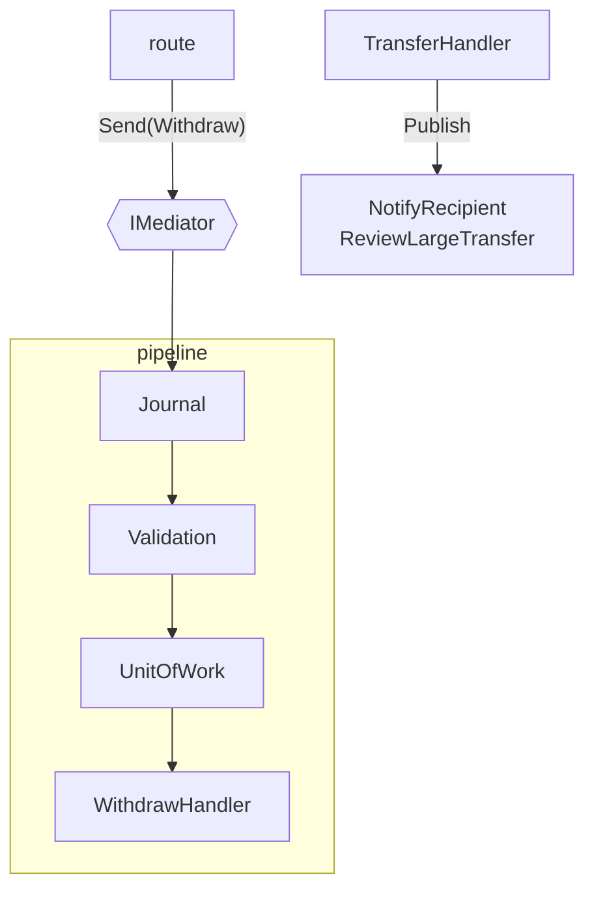

# Cheat sheet 26 · Mediator

> **In one sentence**: you no longer call the code that serves you, you **send a message** to a mediator, which finds
> its handler, wraps it in a common **pipeline** and broadcasts the **notifications**.

**Family**: code organization · **Origin**: *Gang of Four* (1994); in .NET, MediatR (Jimmy Bogard, 2014) ·
**Demo**: [`26-Mediator`](../../../26-Mediator) (port 5126) · 📖 [Full page](../26-mediator.md) ·
🌐 [Français](../../fiches/26-mediator.md)

## Key points

- **Request**: one handler only, one answer. **Notification**: zero to N handlers, no answer.
- **Behaviors** (*pipeline behaviors*): journal, validation, transaction… written once, applied to every request, in
  registration order (the first is the outermost).
- Handlers **without** validation or `SaveChanges`; request + validator + handler in the same file (vertical slice).
- Notifications **in process, synchronous, in the sender's transaction**: a broken subscriber cancels everything.

| ✅ When to use it | ❌ Less suited if |
|---|---|
| Many use cases sharing validation, transaction, audit, permissions | Small application: a direct call reads better |
| With vertical slices | The real need is to separate reads and writes (that is CQRS) |

**Traps**: "go to definition" leads to `IMediator`; a request without a handler **compiles** (run-time error: an
architecture test must check one handler per request); invisible cascading calls; **mistaken for CQRS**: a mediator
doesn't separate the models ([Mediator or CQRS?](../differences/18-mediator-vs-cqrs.md)).

**Takeaway**: MediatR is paid for companies since 2025; the core fits in about a hundred lines, and a decorator on a
service interface also gives a pipeline.

---
⬅️ [Transaction Script and Active Record](25-transaction-script-active-record.md) · [Cheat sheet index](README.md)
