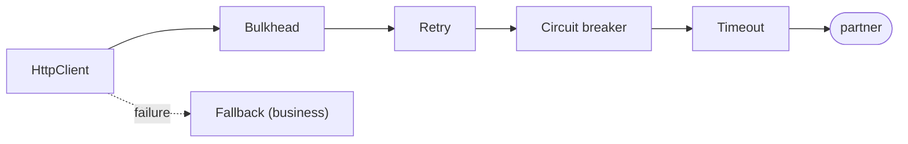

# Cheat sheet 27 · Resilience (timeout, retry, circuit breaker, bulkhead)

**French name**: *Résilience*

> **In one sentence**: don't go down with a service you don't control: cut calls that take too long, retry passing
> failures, stop calling a service that is down, bound what it ties up, and decide what to do without it.

**Family**: system decomposition (what holds a distributed system together) · **Origin**: Michael Nygard, *Release
It!* (2007); Polly in .NET · **Demo**: [`27-Resilience`](../../../27-Resilience) (port 5127) ·
📖 [Full page](../27-resilience.md) · 🌐 [Français](../../fiches/27-resilience.md)

## Key points

- **Timeout** per attempt; **retry** of passing failures only (5xx, 408, 429, network, timeout), doubling wait +
  jitter, never an open circuit.
- **Circuit breaker**: N failures in a row → open (immediate refusal) → after the break, **one** trial call. **Shared**
  state (singleton), outside the handler.
- **Bulkhead**: N calls in progress, M waiting, the others refused at once.
- **The order**: bulkhead → retry → breaker → timeout (that of `AddStandardResilienceHandler`).
- **Fallback**: a business decision (here, ≤ €500 accepted "unverified", otherwise 503 + `Retry-After`).

| ✅ When to use it | ❌ Watch out |
|---|---|
| Every network call to a service you don't control | Only retry what is idempotent |
| Microservices, BFF, partners, remote databases | Settings to test: failures must be simulated |

**Traps**: retry without breaker or jitter (you finish the service off); unshared breaker (never opens); timeout
around the retry instead of each attempt; request body unreadable on the 2nd attempt; forgetting to decide the fallback.

**Takeaway**: in production, `AddStandardResilienceHandler` (demo 8) or Polly; writing them by hand is for knowing what
you are setting.

---
⬅️ [Mediator](26-mediator.md) · [Cheat sheet index](README.md)
