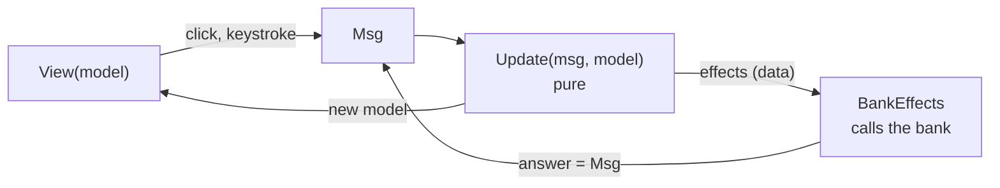

# Cheat sheet 28 · MVU (Model-View-Update)

> **In one sentence**: the whole state of the screen in **one immutable model**; every event is a **message**,
> handled one at a time by a **pure** function (`Update`) that returns the next model and the effects to run; the
> **view** is recomputed from the model, and only the differences reach the screen.

**Family**: presentation · **Origin**: The Elm Architecture (Evan Czaplicki, 2012); Redux (2015); in .NET, Elmish,
Fabulous · **Demo**: [`28-Mvu`](../../../28-Mvu) (console) · 📖 [Full page](../28-mvu.md) ·
🌐 [Français](../../fiches/28-mvu.md)

## Key points

- **A single state**, immutable (`record` + `with`): selection, input, waiting, pending question.
- **The messages**: everything that can happen (clicks, keystrokes, **the bank's answers**), queued, one at a time.
- **Pure `Update`**: no `await`, no call to the bank; it **describes** the effects (`LoadAccounts`), an interpreter
  runs them and sends their results back as messages.
- **What is derived is recomputed** (errors, enabled button): no `Validate()` to call.
- **The view**: a pure function of the model; a greyed-out button = a button without a message. Diff between two views.

| ✅ When to use it | ❌ Less suited if |
|---|---|
| Rich screen, where the history and order of events matter | Small form: bindings (MVVM) go faster |
| Test everything without screen or server, with values | Team and XAML/binding tooling already in place |

**Traps**: one message per keystroke (verbose); a single model that grows (split it); recomputing the view without a
diff (slow); effects started from `Update` instead of described (purity is lost).

**Takeaway**: compare with [MVC and MVVM](24-mvc-mvvm.md): same screen, same model; in MVU, the confirmation question
is a **state**, not an awaited call.

---
⬅️ [Resilience](27-resilience.md) · [Cheat sheet index](README.md)
