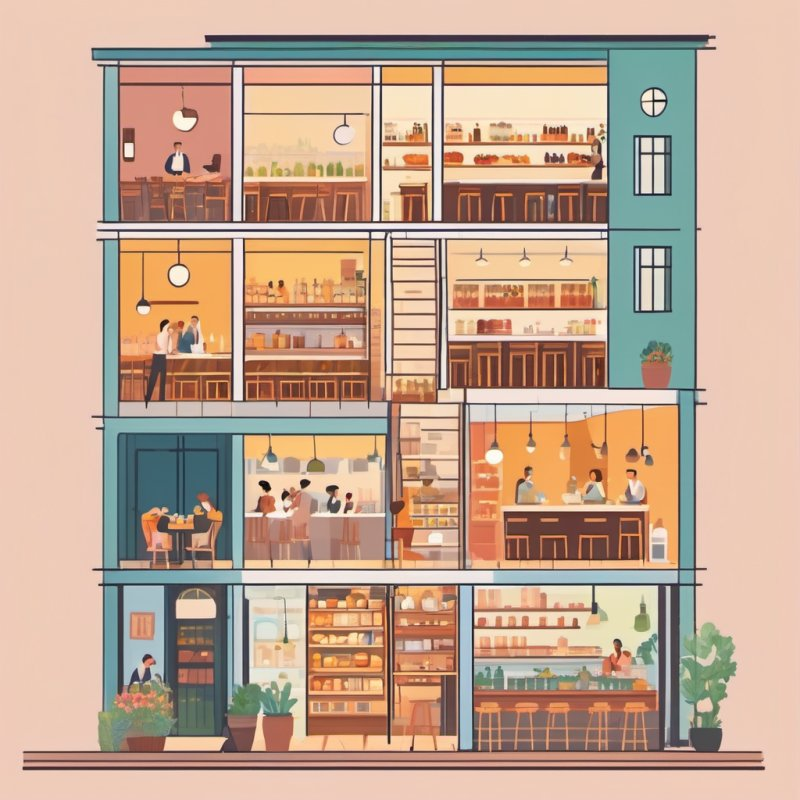

# 0. Layers

**French name**: *Architecture en couches (N-tiers)*

🏠 [Contents](README.md) · ➡️ [Hexagonal](01-hexagonale.md) · 🔧 [Technical version](../00-couches.md) · 🌐 [Français](../../pour-tous/00-couches.md)

> **In one picture**: a restaurant on three floors. The dining room welcomes the customers, the kitchen prepares the
> dishes, the storeroom keeps the ingredients. Each one only talks to the floor below.

---

## The idea

It is the most classic, and the oldest, way of organizing an application. It is arranged on **three floors**:

- **at the top, the reception**: what receives the users' requests (a web page, an app);
- **in the middle, the rules**: what decides ("does Alice have enough money to transfer €250?");
- **at the bottom, the data**: what stores and finds the information in the database.

A request goes down the floors, the answer comes back up. The reception never rummages in the storeroom itself: it goes
through the kitchen.

## Why it's good

- **Everyone understands it right away.** It is the first thing people learn.
- **Each floor has its job**: you know where to look when something goes wrong.
- **Perfect for getting started** and for simple applications, which mostly record and display information.

## What it costs

The flaw is hidden in the direction of the arrows: **the rules depend on the storeroom**. The kitchen is organized around
the way the storeroom arranges its ingredients. If you change the database, or simply the way it stores things, you have
to rework the rules.

And to check a rule, you often have to run the floor below along with it: hard to test the kitchen without a storeroom.

Almost all the other architectures were born to fix this flaw.

## When to choose it

- For a small or medium application, mostly made of forms and lists.
- When the team is starting out, or the project must move fast.
- As a starting point, ready to evolve when the rules become rich.

## In our bank

Three blocks: the reception receives "Alice transfers €250 to Bob", the rules check the balance, the data floor reads and
saves the accounts. A safeguard prevents the reception from skipping a floor to go straight to the data.
