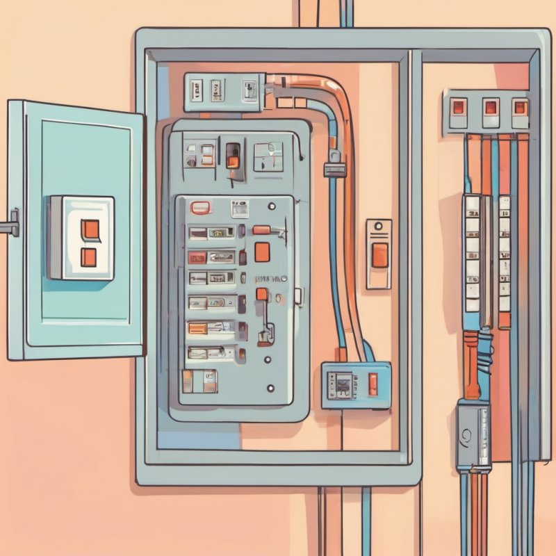

# 27. Resilience (holding on when a partner falters)

🏠 [Contents](README.md) · ⬅️ [Mediator](26-mediator.md) · 🔧 [Technical version](../27-resilience.md) · 🌐 [Français](../../pour-tous/27-resilience.md)

> **In one picture**: the house's **electrical panel**. When an appliance short-circuits, its **breaker** trips: that
> circuit is cut, but the rest of the house keeps the light, and nothing catches fire. You reset it once the appliance
> is repaired. The other protections follow the same idea: a **compartment** that takes on water without sinking the
> whole ship, a **plan B** when the appliance is broken.

---

## The idea

Our bank asks an **outside partner** for its opinion before each transfer: a service that spots fraud. This service
isn't ours. It can be slow, break down for a few seconds, or for an hour. The question is not to prevent it (we can't),
but **not to go down with it**. Five protections, stacked:

- **The timeout**: you don't stay hanging on the phone; after one second without an answer, you hang up.
- **The callback**: a passing failure often fixes itself; you call back, waiting a little longer each time (and not
  everyone at the same second).
- **The circuit breaker**: after five failures in a row, you **stop calling** for thirty seconds. The partner gets a
  breather, and our customers get an answer right away instead of waiting for nothing. Then you try **just once** to
  see if it's better.
- **The compartments**: never more than two calls in progress to this partner, two waiting, the others refused at once.
  If it gets very slow, it only ties up this compartment; the rest of the bank goes on.
- **Plan B**: when there is no opinion, it's a **business decision**. A small transfer goes through anyway, marked
  "unverified", to be checked later; a large one waits for the partner to come back.

## Why it's good

- A failure at the partner's stays **at the partner's**: it doesn't bring the bank down like dominoes.
- Customers get a quick answer, even a bad one, instead of a spinning screen.
- The partner in trouble isn't **finished off** by an avalanche of callbacks.

## What it costs

- Settings to choose (how many callbacks, what delay, what threshold) and to **test**, which means simulating failures.
- Calling back is only safe for a request that can be **repeated**: asking for an opinion, yes; paying, no.
- Plan B is a **business choice**: someone has to decide what is accepted without a check.

## When to choose it

As soon as an application **depends on a service it doesn't control** across the network: a partner, another service
of the company, a remote database. In other words, almost always.

## In our bank

The simulated partner can be broken on demand. Healthy, one call is enough. Flaky, the callbacks make up for its two
failures without the customer noticing. Very slow, each call is cut after one second and a small transfer goes through
"unverified". Down, the breaker opens and the partner is no longer called at all; thirty seconds after it comes back, a
trial call closes the circuit again.
