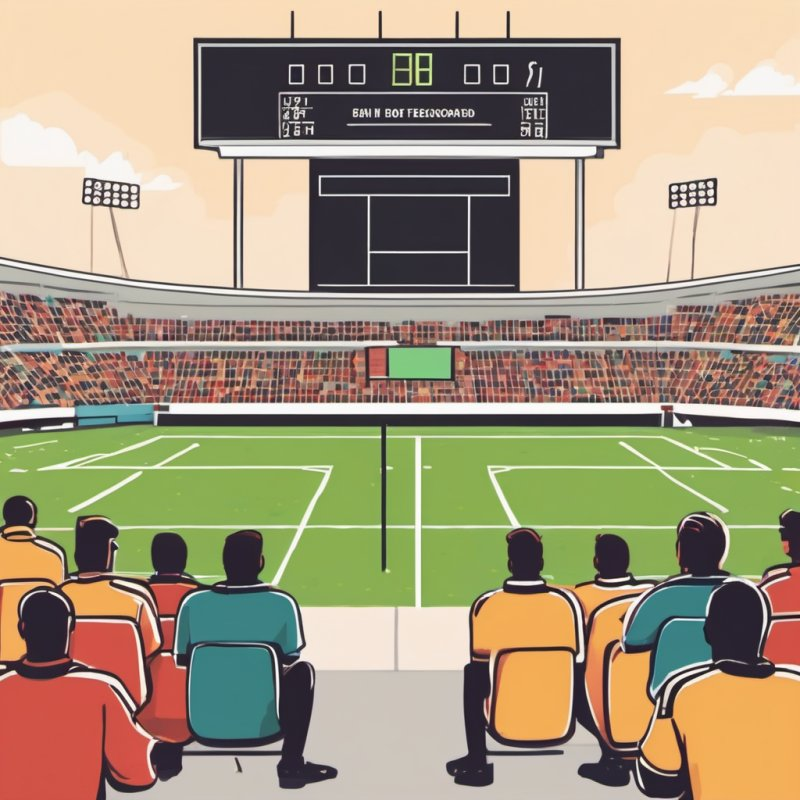

# 28. MVU (the screen that redraws itself)

🏠 [Contents](README.md) · ⬅️ [Resilience](27-resilience.md) · 🔧 [Technical version](../28-mvu.md) · 🌐 [Français](../../pour-tous/28-mvu.md)

> **In one picture**: a match's **scoreboard**. Nobody writes on it by hand. At each event (a goal, a foul), the
> referee writes the match's **new state** on a sheet, one event at a time, and the board is redisplayed from that
> sheet. The board only shows the sheet.

---

## The idea

[Page 24](24-mvc-mvvm.md) showed two ways of organizing a screen: the mail (MVC) and the dashboard that moves live
(MVVM). Here is the third one, which came from the **Elm** language and was made popular by **React** and **Redux**:
**MVU**, for Model, View, Update.

- **The model**: everything the screen knows, gathered on **a single sheet**: the chosen account, the amount typed, the
  transfer in progress, the question waiting. Nothing is ever crossed out: each change gives a **new sheet**.
- **The messages**: everything that can happen, written down: "the user typed 250", "the bank answered". They queue up
  and are handled **one by one**.
- **The update**: a rule that, from a sheet and a message, makes the next sheet. It does nothing else: when the bank has
  to be called, it **writes it down** ("ask for the accounts"), and someone else does it.
- **The view**: redrawn entirely from the sheet, every time. Only what changed is really modified on screen.

## Why it's good

- **Everything is in the same place**: to know what the screen does, you read the list of messages and the update rule.
  Nothing happens behind your back.
- **Easy to check**: you give a sheet and a message, you look at the sheet you get. No bank, no screen, no waiting.
- **No surprise**: one message at a time, so never two changes stepping on each other; an answer arriving late for an
  account you have left is simply ignored.

## What it costs

- **Everything goes through messages**, even the smallest change: it takes longer to write than a simple binding.
- **The view is recomputed entirely** every time; a mechanism is needed that only modifies what changed.
- A single big sheet for a very large screen gets heavy; it is then split into pieces.

## When to choose it

- For a screen **rich in interactions**, where you need to know exactly what happened and in what order.
- When you want to **check the whole behaviour** without a screen or a server.
- It is how many modern web applications work (React with Redux, Elm) and some .NET applications (Fabulous, Elmish).

## In our bank

The same screen as on page 24, with the same bank behind it. Every keystroke, every click and every answer of the bank
is a message. A withdrawal that is too large is flagged as soon as it is typed, the button stays greyed out, and from
€1,000 a question is shown: it is simply part of the sheet, waiting for the "yes" or "no" answer.
