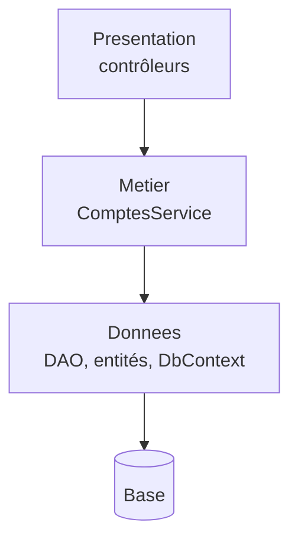

# Fiche 0 · Couches (N-tiers)

> **En une phrase** : Présentation → Métier → Données ; chaque couche n'appelle que celle du dessous.

**Famille** : organisation du code · **Origine** : usage courant depuis les années 1990 ·
**Démo** : [`00-Couches`](../../00-Couches) (port 5100) · 📖 [Page complète](../00-couches.md)

## L'essentiel

- On sépare les responsabilités **techniques**, empilées.
- **Les dépendances descendent jusqu'à la base** : le métier dépend de la couche données (son interface, ses entités).
- Les entités sont **anémiques** : les règles vivent dans les services.
- Garde-fou : références de projets **non transitives** (la présentation ne voit pas les données).

| ✅ Quand l'utiliser | ❌ Signaux pour en sortir |
|---|---|
| CRUD au métier mince, prototype, équipe débutante | Règles qui se multiplient, à tester sans base |
| Démarrer vite, avec une structure que tout le monde connaît | Changement de stockage envisagé |

**Piège** : une fonctionnalité = des modifications dans toutes les couches ; le métier est couplé à la persistance.

**Évolutions** : inverser les dépendances → [Hexagonale](01-hexagonale.md), [Onion](02-onion.md) ; ranger par
fonctionnalité → [Vertical Slice](05-vertical-slice.md).

---
[Index des fiches](README.md) · ➡️ [Hexagonale](01-hexagonale.md)
