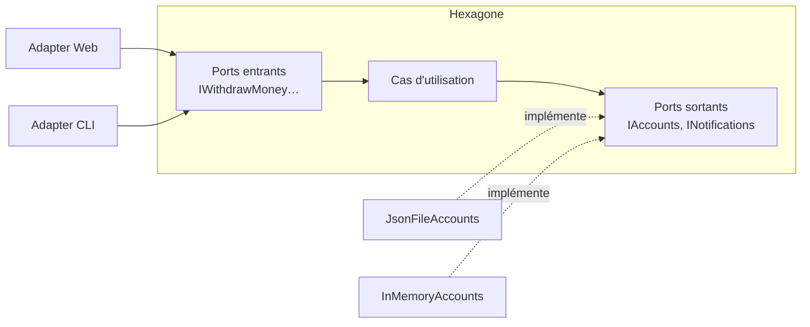

# Fiche 1 · Hexagonale (Ports & Adapters)

**Nom anglais** : *Hexagonal Architecture (Ports & Adapters)*

> **En une phrase** : le métier au centre ne dépend de rien ; le monde s'y branche par des **ports** (interfaces) et des
> **adapters** (implémentations) interchangeables.

**Famille** : organisation du code · **Origine** : Alistair Cockburn, 2005 ·
**Démo** : [`01-Hexagonal`](../../01-Hexagonal) (port 5101, + une CLI) · 📖 [Page complète](../01-hexagonale.md) ·
🌐 [English](../en/fiches/01-hexagonale.md)

## L'essentiel

- Intérieur / extérieur plutôt que haut / bas. **Toutes les dépendances pointent vers l'hexagone**.
- Port **entrant** = ce que l'application offre ; port **sortant** = ce dont elle a besoin.
- La *composition root* (`Program.cs`) est le seul endroit qui connaît hexagone et adapters.
- **Tests de contrat** : la même suite tourne sur chaque adapter d'un port.

| ✅ Quand l'utiliser | ❌ Moins utile si |
|---|---|
| Métier riche, infrastructure susceptible de changer | CRUD simple sans règles |
| Plusieurs canaux d'entrée (API, CLI, messages) | Un seul adapter par port, pour toujours |

**Piège** : les ports « passe-plat » qui n'apportent rien ; le centre lui-même n'est pas structuré.

**Voisins** : même règle de dépendance que [Onion](02-onion.md) et [Clean](03-clean.md).

---
⬅️ [Couches](00-couches.md) · [Index des fiches](README.md) · ➡️ [Onion](02-onion.md)
