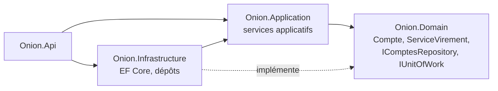

# Fiche 2 · Onion

> **En une phrase** : des couches concentriques ; le domaine au centre, **toutes les dépendances pointent vers lui**.

**Famille** : organisation du code · **Origine** : Jeffrey Palermo, 2008 ·
**Démo** : [`02-Onion`](../../02-Onion) (port 5102) · 📖 [Page complète](../02-onion.md) ·
🌐 [English](../en/fiches/02-onion.md)

## L'essentiel

- Même règle que l'hexagonale, mais le **centre est découpé** : modèle du domaine → services de domaine → services applicatifs.
- Les interfaces d'accès aux données (`IComptesRepository`, `IUnitOfWork`) sont **dans le domaine** ; l'infrastructure les implémente.
- Le service applicatif orchestre : charger, déléguer au domaine, enregistrer (unité de travail, tout ou rien).

| ✅ Quand l'utiliser | ❌ Moins utile si |
|---|---|
| Métier riche, avec des règles sur plusieurs entités | Petite application : beaucoup de projets et d'interfaces |
| Besoin d'un centre structuré et d'une unité de travail explicite | Équipe qui ne distingue pas service de domaine et applicatif |

**Piège** : les règles migrent dans les services → modèle anémique.

**Hexagonale ou Onion ?** Même règle ; l'une insiste sur les ports autour, l'autre sur les couches au centre.
Beaucoup de projets « Clean » .NET sont en fait des Onion.

---
⬅️ [Hexagonale](01-hexagonale.md) · [Index des fiches](README.md) · ➡️ [Clean](03-clean.md)
