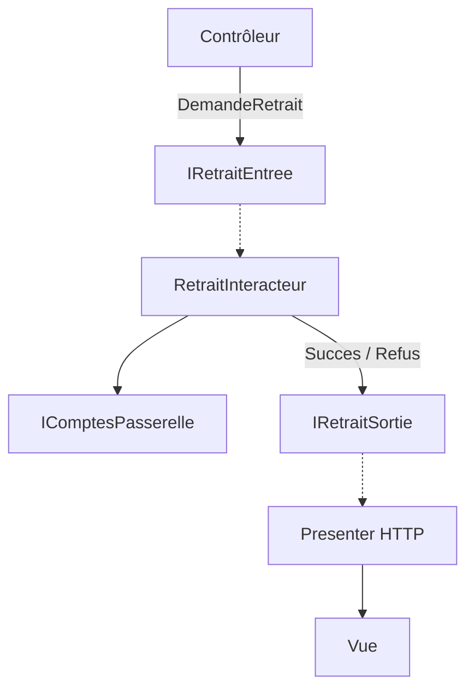

# Fiche 3 · Clean Architecture

> **En une phrase** : un *interactor* par cas d'utilisation, des frontières explicites ; il ne renvoie rien et pousse son
> résultat vers un *presenter*.

**Famille** : organisation du code · **Origine** : Robert C. Martin, 2012 ·
**Démo** : [`03-Clean`](../../03-Clean) (port 5103) · 📖 [Page complète](../03-clean.md) ·
🌐 [English](../en/fiches/03-clean.md)

## L'essentiel

- Quatre cercles : **Entities → Use Cases → Interface Adapters → Frameworks & Drivers**.
- **Règle de dépendance** : un cercle ne connaît que les cercles plus intérieurs.
- Vocabulaire : request / response model, input / output boundary, interactor, presenter, gateway.
- L'inversion de dépendance s'applique aussi à la **sortie** : l'interacteur appelle le presenter via une interface qu'il définit.

| ✅ Quand l'utiliser | ❌ Moins utile si |
|---|---|
| Plusieurs présentations d'un même cas d'utilisation | API web simple : presenter à état peu naturel en ASP.NET Core |
| Cas d'utilisation nombreux, à rendre explicites | Équipe qui l'appliquerait de façon dogmatique |

**Piège** : la **cérémonie** (6 types pour un retrait). En pratique, les modèles .NET (Jason Taylor, Ardalis) gardent
les cercles et remplacent le presenter par un `Result<T>`.

**Comparer** : le même retrait tient en un fichier en [Vertical Slice](05-vertical-slice.md).

---
⬅️ [Onion](02-onion.md) · [Index des fiches](README.md) · ➡️ [Cœur fonctionnel](04-coeur-fonctionnel.md)
