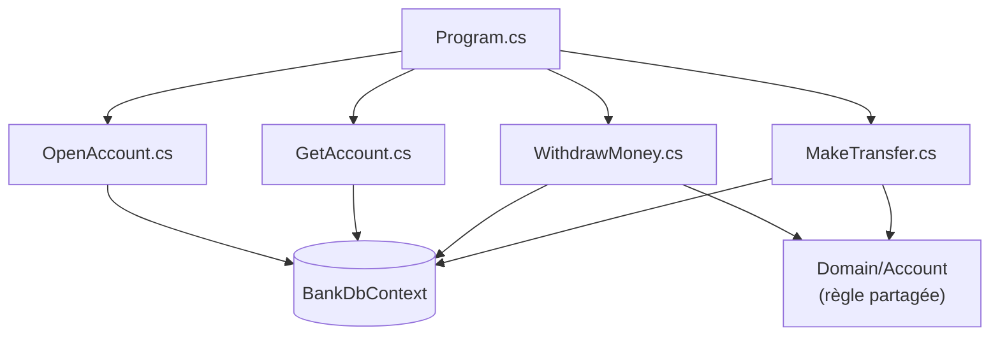

# Fiche 5 · Vertical Slice

> **En une phrase** : le code rangé **par fonctionnalité** ; chaque tranche contient tout, de la route HTTP jusqu'à la base.

**Famille** : organisation du code · **Origine** : Jimmy Bogard, vers 2018 ·
**Démo** : [`05-VerticalSlice`](../../05-VerticalSlice) (port 5105) · 📖 [Page complète](../05-vertical-slice.md) ·
🌐 [English](../en/fiches/05-vertical-slice.md)

## L'essentiel

- Une tranche = une requête ou une commande, dans **un fichier**.
- **Couplage fort dans** la tranche, **faible entre** les tranches.
- Chaque tranche choisit sa technique (projection LINQ, entité, SQL…).
- Pas d'abstraction « au cas où » : le `DbContext` est déjà dépôt + unité de travail. Seules les règles **partagées** remontent dans `Domain/`.

| ✅ Quand l'utiliser | ❌ Moins adapté si |
|---|---|
| API de gestion, livraison fonctionnalité par fonctionnalité | Changement de base probable (le `DbContext` est partout) |
| Dans chaque module d'un monolithe modulaire | Équipe peu disciplinée sur le code partagé |

**Piège** : duplication et handlers obèses si l'on ne remonte jamais rien. (MediatR est payant en entreprise depuis 2025.)

**Voisins** : l'axe vertical continue avec [Composants](06-composants.md) puis [Monolithe modulaire](07-monolithe-modulaire.md).

---
⬅️ [Cœur fonctionnel](04-coeur-fonctionnel.md) · [Index des fiches](README.md) · ➡️ [Composants](06-composants.md)
