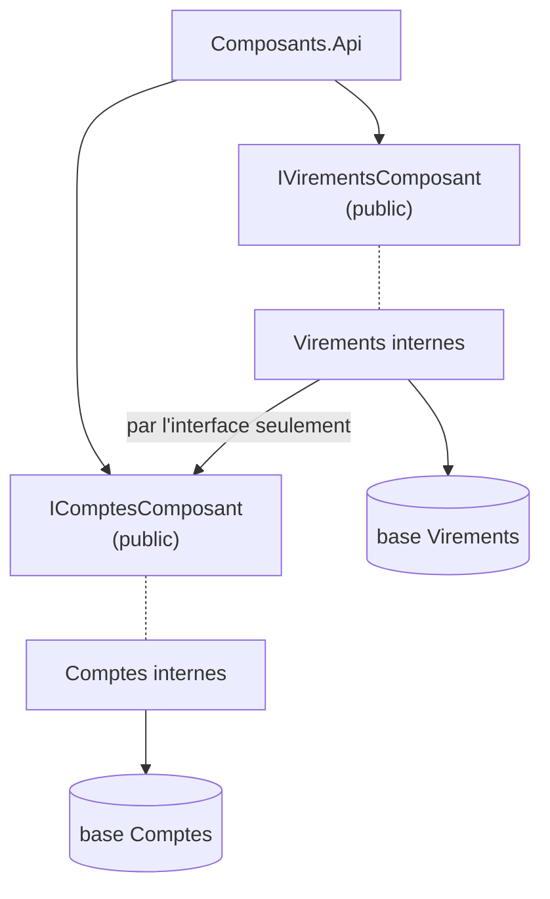

# Fiche 6 · Package by Component

> **En une phrase** : une **seule interface publique** par composant, tout le reste `internal` ; le compilateur fait
> respecter l'architecture.

**Famille** : découpage du système · **Origine** : Simon Brown, « The Missing Chapter » (*Clean Architecture*) ·
**Démo** : [`06-Composants`](../../06-Composants) (port 5106) · 📖 [Page complète](../06-composants.md) ·
🌐 [English](../en/fiches/06-composants.md)

## L'essentiel

- Constat : si tout est `public`, rien n'empêche un contrôleur d'appeler le dépôt directement.
- Un composant = métier + données derrière une interface ; un raccourci **ne compile pas**.
- **Une base par composant** : Virements ne lit jamais les tables de Comptes.

| ✅ Quand l'utiliser | ❌ Coût |
|---|---|
| Faire respecter des frontières sans test ni revue | Concevoir de bonnes interfaces publiques demande du soin |
| Préparer un futur monolithe modulaire | Plus de transaction commune : compensation nécessaire |

**À retenir** : une architecture que ni `internal` ni un test d'architecture (NetArchTest, ArchUnitNET) ne protège
finit toujours contournée.

**Étape suivante** : des composants qui possèdent aussi leur API et leurs événements → [Monolithe modulaire](07-monolithe-modulaire.md).

---
⬅️ [Vertical Slice](05-vertical-slice.md) · [Index des fiches](README.md) · ➡️ [Monolithe modulaire](07-monolithe-modulaire.md)
