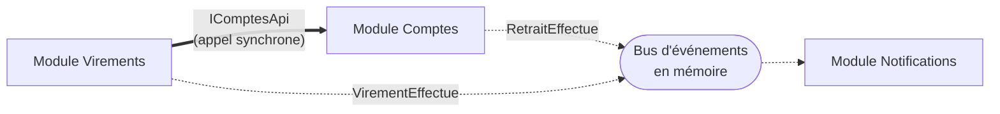

# Fiche 7 · Monolithe modulaire

> **En une phrase** : des modules autonomes (API, base, événements) reliés par des **contrats**, déployés ensemble dans
> un seul processus.

**Famille** : découpage du système · **Origine** : popularisé notamment par Shopify ·
**Démo** : [`07-MonolitheModulaire`](../../07-MonolitheModulaire) (port 5107) · 📖 [Page complète](../07-monolithe-modulaire.md)

## L'essentiel

- Un module = une mini-application (routes, base, abonnements) branchée d'une ligne : `IModule[] modules = [...]`.
- Règles, vérifiées par tests d'architecture :
  1. on ne référence que les **Contrats** d'un autre module, jamais son implémentation ;
  2. seule la classe `IModule` est publique ;
  3. les contrats ne dépendent d'aucun module ;
  4. **une base par module**.

| ✅ Quand l'utiliser | ❌ Limites |
|---|---|
| **Point de départ recommandé** d'un système qui grandit | Pas de mise à l'échelle indépendante des modules |
| Plusieurs sous-domaines, une seule équipe d'exploitation | Ni transaction ni jointure entre modules |

**Piège** : le bus en mémoire perd les événements en cas de crash → [outbox](../concepts-transverses.md#outbox).
Une mauvaise découpe coûte cher : trouver les frontières avec le [DDD](11-ddd.md).

**Étape suivante** : un module à déployer à part → ses contrats deviennent une API réseau → [Microservices](08-microservices.md).

---
⬅️ [Composants](06-composants.md) · [Index des fiches](README.md) · ➡️ [Microservices](08-microservices.md)
