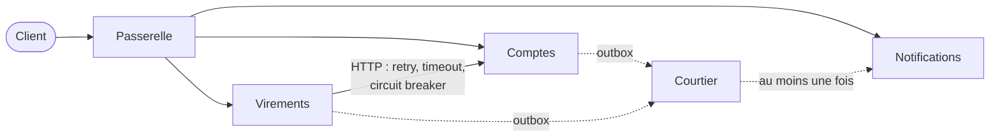

# Fiche 8 · Microservices

> **En une phrase** : un **processus par service**, une base chacun, déployable seul ; communication par le **réseau**
> (HTTP + messages), aucun code partagé.

**Famille** : découpage du système · **Démo** : [`08-Microservices`](../../08-Microservices) (passerelle 5200,
services 5201–5203, courtier 5209 ; tout démarrer avec `Micro.Lanceur`) · 📖 [Page complète](../08-microservices.md)

## L'essentiel

- La démo 7 coupée en processus : appel de méthode, transaction, événement en mémoire passent par **un réseau qui peut échouer**.
- Le contrat, c'est le **JSON échangé** : aucune référence entre services.
- Mécanismes obligatoires : **idempotence** (`operationId`, `Message-Id`), **outbox**, client résilient,
  **saga + compensation**, passerelle qui cache les routes `/interne/…`.

| ✅ Quand l'utiliser | ❌ Éviter si |
|---|---|
| Plusieurs équipes, cycles de déploiement indépendants | Une seule équipe : le monolithe modulaire suffit |
| Besoins de mise à l'échelle très différents | Pas d'outillage d'exploitation (traces, supervision) |

**Piège** : pannes partielles et cohérence à terme partout ; l'essentiel du code gère les échecs.

**En production** : RabbitMQ / Azure Service Bus, YARP, .NET Aspire ou Kubernetes, OpenTelemetry.
Mécanismes : [concepts transverses](../concepts-transverses.md).

---
⬅️ [Monolithe modulaire](07-monolithe-modulaire.md) · [Index des fiches](README.md) · ➡️ [CQRS](09-cqrs.md)
