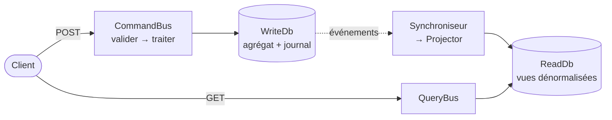

# Fiche 9 · CQRS

> **En une phrase** : un modèle pour **écrire** (les règles), un autre pour **lire** (des vues prêtes à afficher), reliés
> par des événements.

**Famille** : modélisation · **Origine** : Greg Young, vers 2010, d'après le CQS de Bertrand Meyer ·
**Démo** : [`09-CQRS`](../../09-CQRS) (port 5108) · 📖 [Page complète](../09-cqrs.md) ·
🌐 [English](../en/fiches/09-cqrs.md)

## L'essentiel

- Écrire et lire n'ont pas les mêmes besoins : cohérence et invariants d'un côté, rapidité et formes variées de l'autre.
- Une commande ne renvoie rien (ou un identifiant) ; une requête ne modifie rien.
- Les deux côtés **ne se référencent pas** : seul lien, le projet des événements.
- Les vues sont **reconstructibles** à partir des événements.

| ✅ Quand l'utiliser | ❌ Excessif si |
|---|---|
| Lectures bien plus nombreuses ou très différentes des écritures | CRUD simple |
| Écrans qui veulent des vues pré-calculées | La cohérence immédiate est exigée partout |

**Pièges de vocabulaire** : CQRS **n'impose pas deux bases** (séparer les modèles sur une même base suffit souvent) ;
CQRS **n'est pas** l'Event Sourcing (ici, l'état est stocké normalement).

**Coût** : données dupliquées, projections à maintenir, cohérence à terme à expliquer.

---
⬅️ [Microservices](08-microservices.md) · [Index des fiches](README.md) · ➡️ [Event Sourcing](10-event-sourcing.md)
