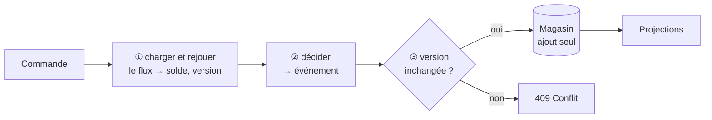

# Fiche 10 · Event Sourcing

> **En une phrase** : on stocke la **suite des événements**, pas l'état ; l'état se recalcule en les rejouant, et on
> n'efface jamais rien.

**Famille** : modélisation · **Démo** : [`10-EventSourcing`](../../10-EventSourcing) (port 5109 ; magasin lisible :
`Es.Api\evenements.jsonl`) · 📖 [Page complète](../10-event-sourcing.md) ·
🌐 [English](../en/fiches/10-event-sourcing.md)

## L'essentiel

- Le solde n'est qu'un **calcul** sur les faits (ouvert, retiré, viré…), comme en comptabilité.
- Agrégat en deux temps : **décider** (règles → événement) puis **appliquer** (événement → état).
- **Concurrence optimiste** par numéro de version ; **instantanés** pour ne pas tout rejouer.
- **Upcasting** des anciennes versions d'événements ; tests **Given / When / Then**.

| ✅ Quand l'utiliser | ❌ Excessif si |
|---|---|
| L'historique est une donnée métier : banque, compta, assurance, audit | CRUD, ou module sans besoin d'historique |
| Voyage dans le temps, nouvelles vues rétroactives | Équipe pressée : courbe d'apprentissage réelle |

**Pièges** : on corrige par un événement **compensatoire** ; les événements se **versionnent pour toujours** ;
**RGPD** : chiffrer les données personnelles et détruire la clé.

**Voisins** : presque toujours avec [CQRS](09-cqrs.md) pour les lectures. En production : EventStoreDB, Marten, Axon.

---
⬅️ [CQRS](09-cqrs.md) · [Index des fiches](README.md) · ➡️ [DDD](11-ddd.md)
