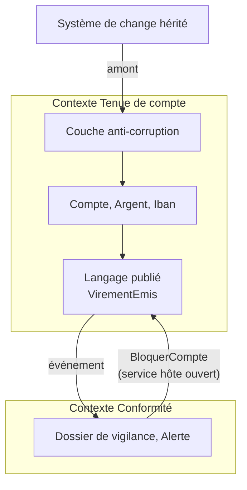

# Fiche 11 · Domain-Driven Design (DDD)

> **En une phrase** : partir du métier, parler **sa** langue, et laisser le modèle guider le code, dans un contexte
> (tactique) comme entre contextes (stratégique).

**Famille** : modélisation · **Origine** : Eric Evans, *Domain-Driven Design*, 2003 ·
**Démo** : [`11-DDD`](../../11-DDD) (port 5110, base Onion) · 📖 [Page complète](../11-ddd.md)

## L'essentiel

- **Stratégique** : contextes délimités (un « compte » n'est pas le même en Tenue de compte et en Conformité),
  carte des contextes, langage publié, couche anti-corruption.
- **Tactique** : langage omniprésent (glossaire `LANGAGE.md` = noms du code), **objets-valeurs toujours valides**
  (`Iban`, `Argent`), agrégats, fabriques, services de domaine, dépôts, événements de domaine.
- Ce n'est **pas une organisation de dossiers** mais une démarche, applicable avec Hexagonale, Onion ou Clean.

| ✅ Quand l'utiliser | ❌ Excessif si |
|---|---|
| Métier complexe, experts disponibles | CRUD : beaucoup de cérémonie |
| Trouver **où couper** modules et services | Pas d'accès aux experts métier |

**Piège** : le réduire à sa boîte à outils tactique ; découper les contextes est difficile et coûteux à corriger.

**Liens** : contextes → modules ([7](07-monolithe-modulaire.md)) ou services ([8](08-microservices.md)) ; agrégats →
flux d'événements ([10](10-event-sourcing.md)).

---
⬅️ [Event Sourcing](10-event-sourcing.md) · [Index des fiches](README.md) · ➡️ [Serverless](12-serverless.md)
