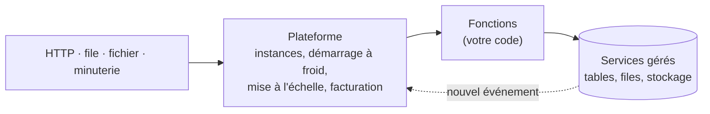

# Fiche 12 · Serverless (FaaS)

> **En une phrase** : des **fonctions sans état** exécutées à la demande quand un **événement** survient, sur des
> serveurs gérés par le fournisseur, facturées à l'usage.

**Famille** : découpage du système · **Origine** : AWS Lambda, 2014 ·
**Démo** : [`12-Serverless`](../../12-Serverless) (port 5111, plateforme **simulée**) · 📖 [Page complète](../12-serverless.md) ·
🌐 [English](../en/fiches/12-serverless.md)

## L'essentiel

- « Serverless » = **sans serveur à gérer**. On écrit des fonctions courtes et un **manifeste** (quelle fonction, quel déclencheur).
- Boucle **événementielle** : une fonction écrit dans une file ou le stockage, ce qui en déclenche une autre.
- État uniquement dans des **services gérés** (concurrence par ETag) ; files avec file *poison*.
- Dans la démo, `Sls.Plateforme` joue le fournisseur ; seul `Sls.Fonctions` serait écrit en vrai.

| ✅ Quand l'utiliser | ❌ Éviter si |
|---|---|
| Fichiers, messages, webhooks, tâches planifiées | Forte charge constante (coût élevé) |
| API à trafic irrégulier, « colle » entre services cloud | Latence stricte (démarrages à froid), traitements longs |

**Pièges** : **idempotence** obligatoire (livraisons multiples), dépendance au fournisseur, limites de durée et de mémoire.

**Pour passer au réel** : Azure Functions (isolated worker) ou AWS Lambda, Azurite / LocalStack, Durable Functions /
Step Functions pour orchestrer.

---
⬅️ [DDD](11-ddd.md) · [Index des fiches](README.md) · ➡️ [Microkernel](13-microkernel.md)
