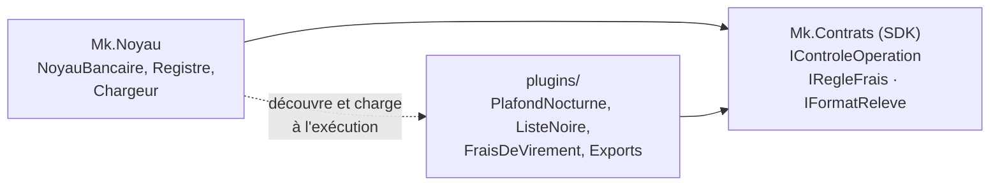

# Fiche 13 · Microkernel (plugins)

> **En une phrase** : un **noyau minimal** qui définit des points d'extension ; les fonctionnalités variables sont des
> **plugins** chargés, déchargés et mis à jour à chaud.

**Famille** : organisation du code · **Exemples** : VS Code, Eclipse, navigateurs, logiciels de paie ·
**Démo** : [`13-Microkernel`](../../13-Microkernel) (port 5112 ; compiler la solution avant, `plugins/` est une sortie
de compilation) · 📖 [Page complète](../13-microkernel.md) ·
🌐 [English](../en/fiches/13-microkernel.md)

## L'essentiel

- Le noyau ne référence **aucun** plugin ; les plugins ne voient que le **SDK**.
- Trois points d'extension : **refuser** une opération, **ajouter des frais**, **produire un relevé** (une DLL peut en contenir plusieurs).
- Un contexte de chargement par plugin : déchargement possible, réglages par `plugin.json`, surveillance du dossier.
- Un plugin défaillant est écarté.

| ✅ Quand l'utiliser | ❌ Attention si |
|---|---|
| Produit configurable par client, pays, offre | Points d'extension instables : les changer casse tous les plugins |
| Moteurs de règles, extensions par des tiers | Plugins non fiables : ils tournent **dans le processus** |

**Pièges** : copier le SDK dans le dossier du plugin (types incompatibles) ; garder une référence vers un plugin
(déchargement impossible) ; le SDK est un contrat public à **versionner**.

**En .NET** : *McMaster.NETCore.Plugins* encapsule ce mécanisme.

---
⬅️ [Serverless](12-serverless.md) · [Index des fiches](README.md) · ➡️ [Saga orchestrée](14-saga-orchestree.md)
