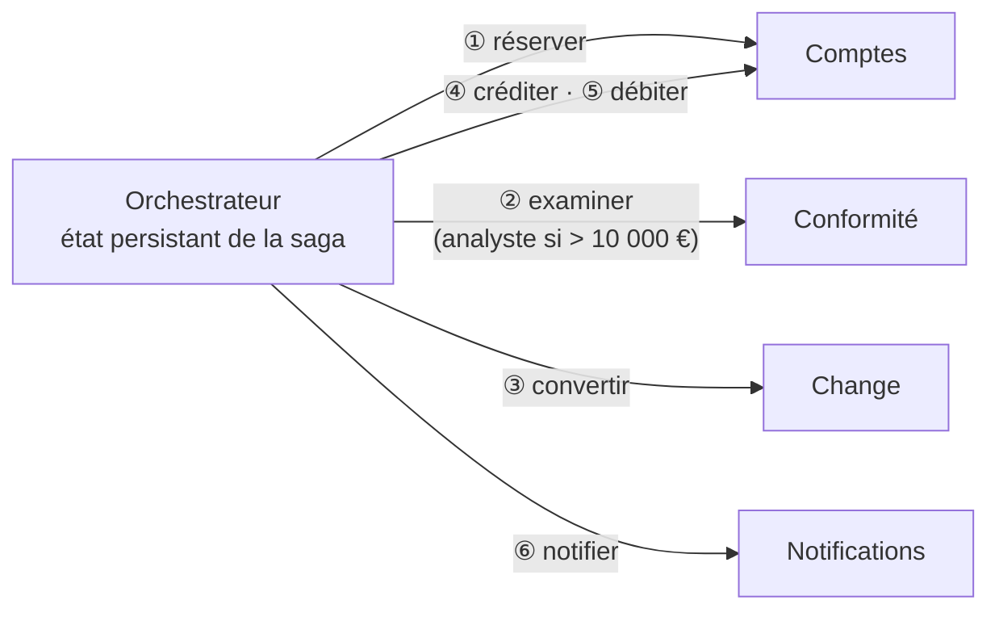

# Fiche 14 · Saga orchestrée

**Nom anglais** : *Orchestrated Saga*

> **En une phrase** : un **orchestrateur** pilote un processus réparti sur plusieurs services, mémorise où il en est,
> réessaie, attend, et **compense** en ordre inverse si besoin.

**Famille** : découpage du système · **Origine** : sagas, Garcia-Molina et Salem, 1987 ·
**Démo** : [`14-SagaOrchestree`](../../14-SagaOrchestree) (port 5113) · 📖 [Page complète](../14-saga-orchestree.md) ·
🌐 [English](../en/fiches/14-saga-orchestree.md)

## L'essentiel

- Plusieurs services = pas de transaction unique : des étapes locales + des **compensations**.
- Le processus est **écrit en un seul endroit** ; l'état et l'historique de chaque saga sont consultables.
- Le moteur gère **réessais, attentes (humaines), échéances, compensation** et la reprise après plantage.
- Règle pratique : chorégraphie pour **notifier**, orchestration pour **conduire**.

| ✅ Quand l'utiliser | ❌ Attention à |
|---|---|
| Processus longs à plusieurs étapes : commande, virement international, souscription | L'orchestrateur connaît tous les participants (couplage) |
| Attentes humaines, délais, règles d'échec précises | Un composant de plus à rendre hautement disponible |

**Pièges** : participants obligatoirement **idempotents** ; « chef d'orchestre obèse » qui absorbe le métier des participants.

**En production** : ne pas écrire son moteur → Temporal, Durable Functions, Step Functions, sagas MassTransit / NServiceBus.
Comparer avec la [Chorégraphie](21-choregraphie.md) (même virement).

---
⬅️ [Microkernel](13-microkernel.md) · [Index des fiches](README.md) · ➡️ [Multi-tenant](15-multi-tenant.md)
