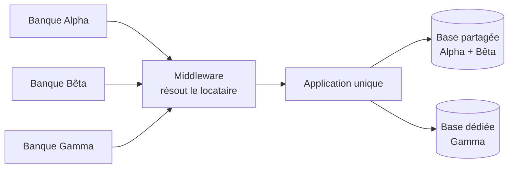

# Fiche 15 · Multi-tenant (SaaS)

> **En une phrase** : **une** application, **un** déploiement, pour **plusieurs clients** (locataires), chacun avec ses
> données, ses règles et ses quotas, sans jamais voir ceux des autres.

**Famille** : découpage du système · **Démo** : [`15-MultiTenant`](../../15-MultiTenant) (port 5114 ; locataire par
sous-domaine `beta.localhost:5114` ou en-tête `X-Locataire`) · 📖 [Page complète](../15-multi-tenant.md)

## L'essentiel

- Le locataire est résolu **une fois** (middleware) puis **ambiant** (`ContexteLocataire`).
- Garde-fous : **filtre global** EF Core, **estampillage** automatique à l'écriture, **clé composite** (locataire + id).
- Formules : base partagée par défaut, **base dédiée** pour qui la paie ; quotas contre le **voisin bruyant**.
- `Mt.Locataires` ne contient aucun métier bancaire : le métier reste écrit comme pour une seule banque.

| ✅ Quand l'utiliser | ❌ Coût |
|---|---|
| Le même logiciel vendu à plusieurs organisations (SaaS B2B) | Une erreur d'isolation expose **tous** les clients |
| Nouveau client en quelques secondes, une seule version | Migrations et sauvegardes sur N bases dédiées |

**Piège** : chaque requête, tâche de fond, cache et journal doit **porter le locataire**.

**En production** : locataire issu de l'authentification, Finbuckle.MultiTenant, *Row-Level Security* en seconde barrière.

---
⬅️ [Saga orchestrée](14-saga-orchestree.md) · [Index des fiches](README.md) · ➡️ [BFF](16-bff.md)
