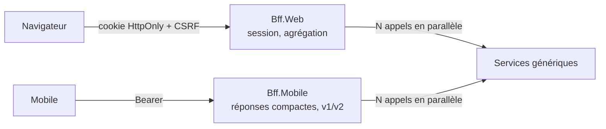

# Fiche 16 · Backend for Frontend (BFF)

> **En une phrase** : **un backend par application cliente**, écrit par son équipe, qui assemble les services génériques
> en réponses taillées pour ses écrans et gère la sécurité à sa façon.

**Famille** : découpage du système · **Origine** : SoundCloud, popularisé par Sam Newman ·
**Démo** : [`16-BFF`](../../16-BFF) (BFF web 5115, BFF mobile 5116, services 5210 ; `alice / demo`) · 📖 [Page complète](../16-bff.md)

## L'essentiel

- Sans BFF : le client enchaîne les appels (lent sur mobile) ou les services ajoutent des routes par écran.
- Un appel par écran ; le BFF appelle les services **en parallèle** et dégrade proprement si l'un tombe.
- Côté web, le **jeton reste sur le serveur** (session + cookie HttpOnly).
- Les BFF ne se référencent pas : contrats **recopiés**, seulement les champs utiles (lecteur tolérant).

| ✅ Quand l'utiliser | ❌ Inutile si |
|---|---|
| Plusieurs applications clientes aux besoins différents | Une seule application, un seul backend (il **est** son BFF) |
| Application monopage qui ne doit pas manipuler de jetons | |

**Pièges** : y glisser des **règles métier** (elles restent dans les services, qui vérifient aussi les droits) ;
sessions à partager entre instances ; duplication voulue, à accepter.

**En production** : Duende BFF, YARP, OpenID Connect. Alternative : [GraphQL](23-rest-grpc-graphql.md) devant les applications.

---
⬅️ [Multi-tenant](15-multi-tenant.md) · [Index des fiches](README.md) · ➡️ [Cellules](17-cell-based.md)
