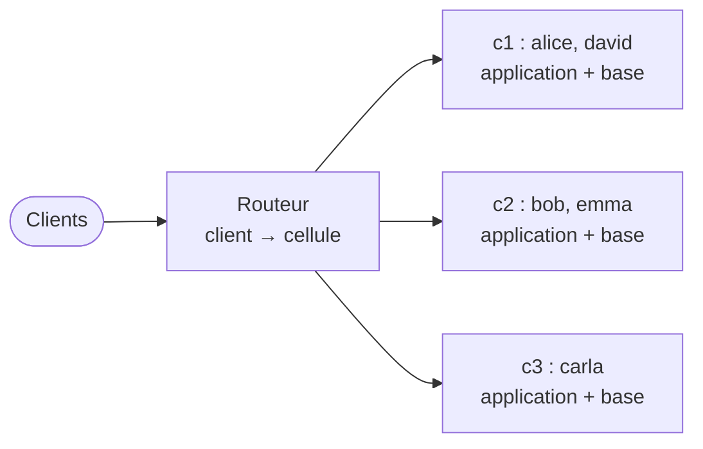

# Fiche 17 · Architecture cellulaire (cell-based)

> **En une phrase** : plusieurs **copies complètes et indépendantes** du système, chacune pour une partie des clients ;
> une panne reste **enfermée dans sa cellule**.

**Famille** : découpage du système · **Démo** : [`17-CellBased`](../../17-CellBased) (routeur 5117, cellules 5231–5234 ;
tout démarrer avec `Cell.Lanceur`) · 📖 [Page complète](../17-cell-based.md)

## L'essentiel

- Objectif : **borner le rayon d'impact** (panne, mauvais déploiement, client gourmand). 50 cellules → un incident touche 2 % des clients.
- Chaque cellule contient **tout** et ne dépend pas des autres.
- Le routeur ne fait que **router** (clé de partition → cellule) ; un plan de contrôle place et déplace les clients.
- Déploiement **par vagues** : la première cellule sert de canari.

| | Découpe… | Une panne touche… |
|---|---|---|
| Microservices | par fonction | une fonction, pour tous |
| **Cellules** | par groupe de clients | tout, pour un groupe |

| ✅ Quand l'utiliser | ❌ Excessif si |
|---|---|
| Très grande échelle : une panne générale coûte plus que N copies | La plupart des systèmes : zones de disponibilité + déploiements progressifs suffisent |
| Clé de partition naturelle (le client) | Beaucoup d'échanges entre clients |

**Pièges** : opérations **entre cellules** lentes et à compenser ; clé de partition qui engage pour longtemps ;
migrations de clients ; routeur à rendre très disponible.

---
⬅️ [BFF](16-bff.md) · [Index des fiches](README.md) · ➡️ [Acteurs](18-modele-acteurs.md)
