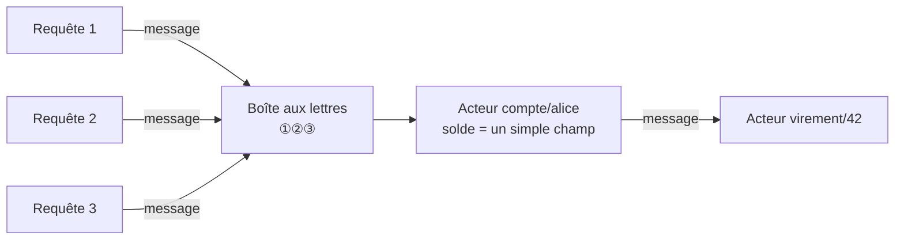

# Fiche 18 · Modèle d'acteurs

**Nom anglais** : *Actor Model*

> **En une phrase** : des milliers d'acteurs à l'**état privé**, qui ne communiquent que **par messages** traités **un par
> un** ; aucun verrou, et un acteur qui plante est **remplacé**.

**Famille** : découpage du système · **Origine** : Carl Hewitt, 1973 ; popularisé par Erlang ·
**Démo** : [`18-ModeleActeurs`](../../18-ModeleActeurs) (port 5118 ; `/systeme` pour observer et provoquer des pannes) ·
📖 [Page complète](../18-modele-acteurs.md) ·
🌐 [English](../en/fiches/18-modele-acteurs.md)

## L'essentiel

- **Chaque donnée a un seul propriétaire** ; la sûreté est structurelle, pas une affaire de discipline.
- Un acteur peut : modifier **son** état, **envoyer** des messages, **créer** des acteurs (ici *virtuels* : on les adresse, le runtime les crée).
- Des acteurs **différents** travaillent en parallèle sur tous les cœurs.
- Une panne : le **superviseur** remplace l'acteur, qui recharge son état durable.

| ✅ Quand l'utiliser | ❌ Moins adapté si |
|---|---|
| Beaucoup d'entités indépendantes, à l'état souvent modifié en concurrence : jeux, IoT, sessions, comptes | Requêtes transversales sur des données relationnelles |
| Passer à l'échelle sur plusieurs machines | Besoin de transactions entre entités |

**Pièges** : pas de transaction entre acteurs (étapes, idempotence, compensation) ; **cycles de demandes =
interblocages** ; un acteur très sollicité devient un goulot ; lectures transversales → vue à part.

**En .NET** : Orleans (acteurs virtuels), Akka.NET ou Proto.Actor (supervision fine).

---
⬅️ [Cellules](17-cell-based.md) · [Index des fiches](README.md) · ➡️ [Spatiale](19-space-based.md)
