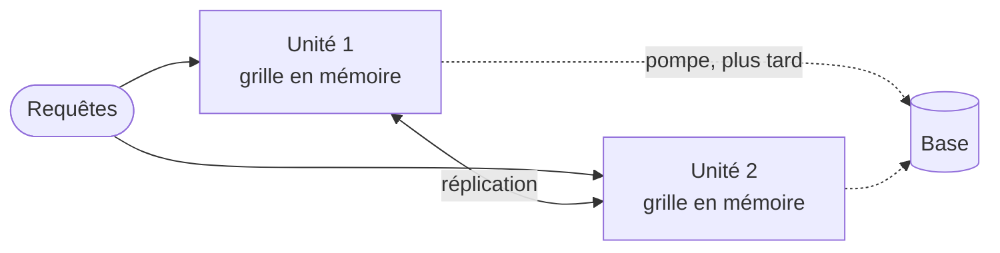

# Fiche 19 · Architecture spatiale (space-based)

**Nom anglais** : *Space-Based Architecture*

> **En une phrase** : la base sort du chemin des requêtes ; chaque **unité de traitement** garde **toutes les données en
> mémoire**, répliquées entre unités, et la base est mise à jour en arrière-plan.

**Famille** : découpage du système · **Origine** : *tuple spaces* ; décrite notamment par Mark Richards ·
**Démo** : [`19-SpaceBased`](../../19-SpaceBased) (port 5119 ; `/grid` pour observer et provoquer des pannes) ·
📖 [Page complète](../19-space-based.md) ·
🌐 [English](../en/fiches/19-space-based.md)

## L'essentiel

- Une requête ne touche que la **mémoire** ; la base n'est plus qu'une **sauvegarde différée**.
- **Élasticité** : une unité démarre en copiant la grille d'une autre ; on en ajoute et retire selon la charge.
- Garde-fous : **versions** sur chaque donnée et **routage par affinité** (même clé → même unité) pour limiter les collisions.
- La base peut tomber sans interrompre le service.

| ✅ Quand l'utiliser | ❌ À éviter si |
|---|---|
| Pics énormes et imprévisibles : billetterie, enchères, réservations, jeux | Données volumineuses (tout doit tenir en mémoire) |
| Données écrites surtout par clé | Base qui doit être à jour à chaque instant (compta, rapports temps réel) |

**Pièges** : **collisions** : des écritures acceptées peuvent être perdues ; base en retard pour les autres systèmes ;
complexe à tester et à exploiter. Mauvais choix pour de vrais soldes : la démo s'en sert pour **montrer** les collisions.

---
⬅️ [Acteurs](18-modele-acteurs.md) · [Index des fiches](README.md) · ➡️ [Pipeline](20-pipeline.md)
