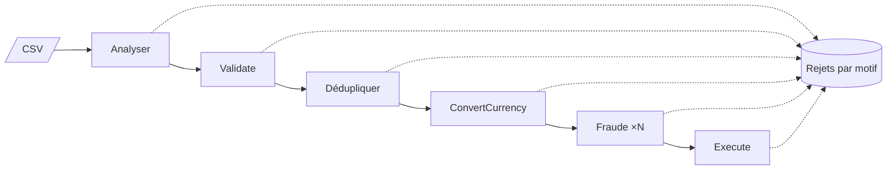

# Fiche 20 · Pipeline (pipes & filters)

> **En une phrase** : des **filtres** indépendants reliés par des **tuyaux bornés**, qui travaillent **en même temps**
> sur un flux de données, comme une chaîne de montage.

**Famille** : organisation du code · **Exemples** : shell Unix, compilateurs, ETL ·
**Démo** : [`20-Pipeline`](../../20-Pipeline) (port 5120 ; `POST /imports` d'un fichier CSV de virements) ·
📖 [Page complète](../20-pipeline.md) ·
🌐 [English](../en/fiches/20-pipeline.md)

## L'essentiel

- Un filtre ne connaît ni sa source, ni sa destination : il reçoit, produit ou **rejette** (avec un motif).
- Un tuyau est **borné** : plein, il fait attendre l'étage d'avant (**contre-pression**) → mémoire bornée, quelle que soit la taille du fichier.
- Tous les étages travaillent en parallèle ; pour accélérer, on trouve le **goulot** et on parallélise **cet** étage seulement.
- Types vérifiés à l'assemblage ; mesures par étage.

| ✅ Quand l'utiliser | ❌ Pas pour |
|---|---|
| Imports / exports, ETL, lots (paie, facturation), flux d'événements, médias | Une application interactive entière |
| Toute suite d'étapes indépendantes sur des données | Des étapes qui ont besoin de tout le jeu de données |

**Pièges** : le débit est celui du plus lent ; les filtres **à état** (dédoublonnage, exécution) restent uniques et
gardent l'ordre ; une panne au milieu laisse un travail partiel → reprise **idempotente**.

**À retenir** : un pipeline se loge **dans** un service ou un module, organisé lui-même selon une autre fiche.

---
⬅️ [Spatiale](19-space-based.md) · [Index des fiches](README.md) · ➡️ [Chorégraphie](21-choregraphie.md)
