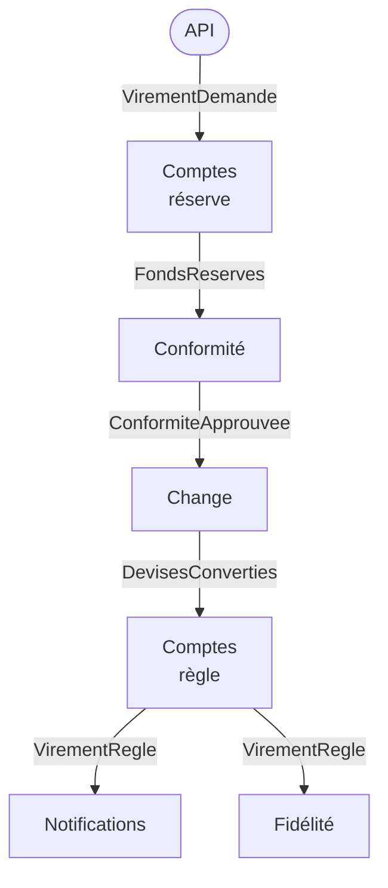

# Fiche 21 · Chorégraphie (événementiel pur)

> **En une phrase** : aucun service ne conduit le processus ; chacun **réagit aux événements** des autres et publie les
> siens.

**Famille** : découpage du système · **Démo** : [`21-Choregraphie`](../../21-Choregraphie) (port 5121 ; `/bus` et
`/chaos` pour observer et casser) · 📖 [Page complète](../21-choregraphie.md)

## L'essentiel

- Le même virement que la [saga orchestrée](14-saga-orchestree.md), mais le processus n'est **écrit nulle part** : il émerge des abonnements.
- Un service ne connaît que des **contrats d'événements** (test d'architecture : aucun service n'en référence un autre).
- Ajouter une réaction = **s'abonner**, sans toucher aux autres.
- « Où en est le virement 42 ? » → une **projection** à construire (le Suivi).

| ✅ Quand l'utiliser | ❌ Préférer l'orchestration si |
|---|---|
| **Réactions** à un fait : notifier, facturer, archiver, synchroniser | Beaucoup d'étapes, attentes, délais, règles d'échec |
| Processus courts, stables, à peu de participants | Besoin de lire et modifier le processus facilement |

**Pièges** : compensations et délais **dispersés** ; une panne se traduit par du **silence** (surveiller lettres mortes
et virements bloqués) ; point unique de défaillance : le courtier.

**Combinaison fréquente** : un orchestrateur conduit, et publie des événements que d'autres chorégraphient.

---
⬅️ [Pipeline](20-pipeline.md) · [Index des fiches](README.md) · ➡️ [Strangler Fig](22-strangler-fig.md)
