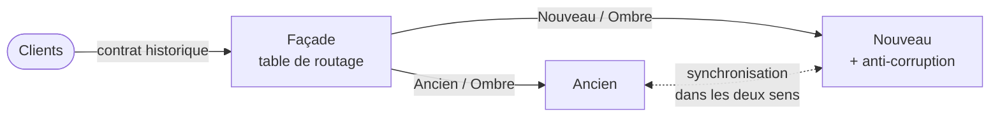

# Fiche 22 · Strangler Fig (migration progressive)

> **En une phrase** : une **façade** devant l'ancien système, qui lui retire ses fonctions **une route à la fois** au
> profit du nouveau, jusqu'à pouvoir l'éteindre.

**Famille** : migration · **Origine** : Martin Fowler, 2004 ·
**Démo** : [`22-StranglerFig`](../../22-StranglerFig) (façade 5122, ancien 5240, nouveau 5241) · 📖 [Page complète](../22-strangler-fig.md) ·
🌐 [English](../en/fiches/22-strangler-fig.md)

## L'essentiel

- Chaque route a un mode : **Ancien**, **Ombre** (l'ancien répond, le nouveau est appelé et comparé), **Nouveau**.
- Table de routage modifiable **à chaud** : chaque pas s'annule **en une requête** ; ce qui n'est pas déclaré reste à l'ancien.
- Le nouveau a son propre modèle et sa base, derrière une **couche anti-corruption**, et reproduit le contrat historique à l'identique.
- Aucun projet ne référence l'ancien : le jour venu, on supprime son projet et l'anti-corruption.

| ✅ Quand l'utiliser | ❌ Moins utile si |
|---|---|
| Système en production qu'on ne peut ni arrêter ni geler | Petit système réécrit en quelques semaines |
| Fonctions découpables en routes, écrans ou messages | Aucun point d'entrée à intercepter |

**Pièges** : synchronisation (boucles, pannes, retard) ; basculer les données **par blocs cohérents** ;
contrat hérité à reproduire, bizarreries comprises ; une migration arrêtée à 80 % = le pire des deux mondes.

**En production** : YARP, Debezium, Scientist / Diffy pour l'ombre, indicateurs de fonctionnalités.

---
⬅️ [Chorégraphie](21-choregraphie.md) · [Index des fiches](README.md) · ➡️ [REST, gRPC, GraphQL](23-rest-grpc-graphql.md)
