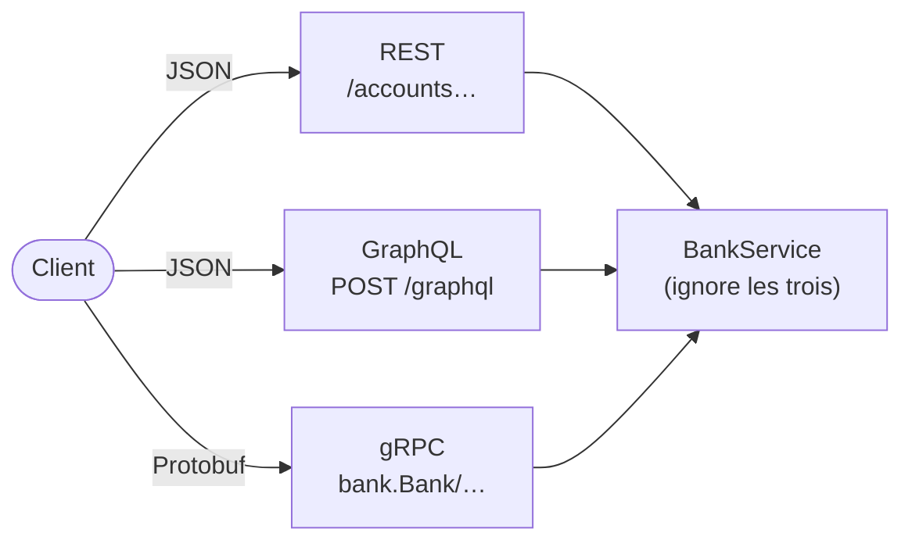

# Fiche 23 · REST, gRPC, GraphQL

> **En une phrase** : le même métier exposé en **ressources** (REST), en **procédures** (gRPC) et en **graphe que le
> client interroge** (GraphQL).

**Famille** : exposition · **Démo** : [`23-RestGrpcGraphQL`](../../23-RestGrpcGraphQL) (REST et GraphQL 5123 en
HTTP/1.1, gRPC 5250 en HTTP/2 ; Protobuf, gRPC et GraphQL écrits à la main) · 📖 [Page complète](../23-rest-grpc-graphql.md) ·
🌐 [English](../en/fiches/23-rest-grpc-graphql.md)

## L'essentiel

| | **REST** | **gRPC** | **GraphQL** |
|---|---|---|---|
| On manipule | des ressources + verbes HTTP | des procédures | un graphe de types |
| Contrat | implicite ou OpenAPI | `.proto`, code généré | schéma SDL, validé avant exécution |
| Forme de la réponse | choisie par le serveur | choisie par le serveur | **choisie par le client** |
| Format / transport | JSON, tout HTTP | binaire, **HTTP/2** obligatoire | JSON, `POST` |
| Erreurs | statut HTTP + `problem+json` | statut gRPC dans les trailers | `200` + `errors` |
| Cache HTTP · flux · navigateur | ✅ · ❌ · ✅ | ❌ · ✅ · ❌ (gRPC-Web) | ❌ · abonnements · ✅ |

## Quand choisir quoi

- **REST** : API publique ou partenaire, ressources simples, cache.
- **gRPC** : entre services internes ; débit, latence, flux, contrats stricts entre équipes.
- **GraphQL** : clients nombreux aux écrans riches ; un aller-retour par écran, à la place d'un [BFF](16-bff.md) par application.

**Pièges** : REST → allers-retours et sur-récupération ; gRPC → illisible sans outil, pas de navigateur ;
GraphQL → **N+1 caché** (DataLoader), requêtes à **borner** (profondeur, coût), cache HTTP perdu.

**À retenir** : le style se choisit **frontière par frontière** ; les trois cohabitent souvent.

---
⬅️ [Strangler Fig](22-strangler-fig.md) · [Index des fiches](README.md) · ➡️ [MVC et MVVM](24-mvc-mvvm.md)
