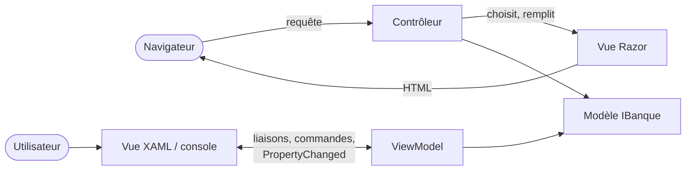

# Fiche 24 · MVC et MVVM

> **En une phrase** : le même écran en **MVC** web (un contrôleur reçoit la requête, choisit une vue, jetée après rendu)
> et en **MVVM** (un ViewModel vivant que la vue observe par liaisons).

**Famille** : présentation · **Démo** : [`24-MvcMvvm`](../../24-MvcMvvm) (site MVC 5124 ; vues WPF, Windows seulement,
et console sur les mêmes ViewModels) · 📖 [Page complète](../24-mvc-mvvm.md)

## L'essentiel

| | **MVC** | **MVVM** |
|---|---|---|
| Reçoit l'action | le contrôleur | la vue, qui la transmet par liaison ou commande |
| Qui connaît qui | le contrôleur choisit la vue | la vue connaît le ViewModel, **pas l'inverse** |
| Durée de vie de l'écran | **une requête** | **tant que la fenêtre est ouverte** |
| Validation | après l'envoi (ModelState) | **à chaque frappe** |
| Testable sans écran | la décision du contrôleur | **tout le comportement** de l'écran |

- Le modèle ignore les écrans (test d'architecture) ; les ViewModels ignorent WPF (autre test).
- Les liaisons XAML ne sont pas compilées : un test **lit le XAML** pour les vérifier.
- Vocabulaire piège : les « view models » d'ASP.NET MVC sont de simples sacs de données, pas des ViewModels MVVM.

| ✅ MVC | ✅ MVVM |
|---|---|
| Site rendu côté serveur, référencement, tenue en charge | Bureau (WPF, WinUI, Avalonia), mobile (MAUI) |

**Pièges** : MVC → une page par étape, état dans des champs cachés. MVVM → abonnements qui fuient, **réponses
asynchrones périmées**, fil d'exécution de l'interface, cérémonie (CommunityToolkit.Mvvm aide).

**À retenir** : MVC et MVVM ne sont que la **couche de présentation** ; le modèle derrière suit n'importe quelle autre fiche.

---
⬅️ [REST, gRPC, GraphQL](23-rest-grpc-graphql.md) · [Index des fiches](README.md)
