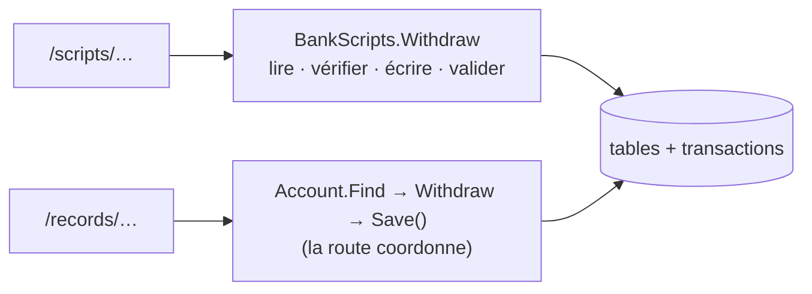

# Fiche 25 · Transaction Script et Active Record

> **En une phrase** : le métier écrit sans architecture : **une procédure par cas d'utilisation**, qui lit et écrit les
> lignes elle-même, ou **un objet par ligne de table**, qui porte ses règles et s'enregistre lui-même.

**Famille** : modélisation (le point de départ) · **Origine** : Martin Fowler, *Patterns of Enterprise Application
Architecture*, 2002 ; Active Record popularisé par Ruby on Rails (2004) ·
**Démo** : [`25-TransactionScriptActiveRecord`](../../25-TransactionScriptActiveRecord) (port 5125) · 📖 [Page complète](../25-transaction-script-active-record.md) ·
🌐 [English](../en/fiches/25-transaction-script-active-record.md)

## L'essentiel

- **Transaction Script** : une méthode par cas d'utilisation, lue de haut en bas ; les lignes ne sont que des données.
- **Une transaction = un script** : tout ou rien (retour arrière si le script lève une exception), une à la fois.
- **Active Record** : l'objet enveloppe sa ligne, se charge (`Find`), porte ses règles (écrites **une** fois) et
  s'écrit (`Save`, `INSERT` ou `UPDATE`).
- Aucune couche entre le code et la base : le métier **dépend de la base** (l'inverse de l'Onion).

| ✅ Quand l'utiliser | ❌ Moins adapté si |
|---|---|
| Métier mince : CRUD, back-office, outils internes, imports | Règles riches qui se croisent d'un cas d'utilisation à l'autre |
| Prototype, application qui restera petite ; Active Record si les objets ressemblent aux tables | Schéma de base éloigné du modèle ; règles à tester sans base |

**Pièges** : règles **recopiées** d'un script à l'autre ; `Save` **oublié** (le changement est perdu) ; coordination qui
s'accumule dans les routes ; tests de règles qui demandent une base.

**À retenir** : on en sort au premier symptôme, et le symptôme dit vers où : règles recopiées → [DDD](11-ddd.md) ;
routes obèses → [Couches](00-couches.md), [Clean](03-clean.md) ; tests qui exigent une base →
[Hexagonale](01-hexagonale.md) ; scripts indépendants → [Vertical Slice](05-vertical-slice.md).

---
⬅️ [MVC et MVVM](24-mvc-mvvm.md) · [Index des fiches](README.md) · ➡️ [Mediator](26-mediator.md)
