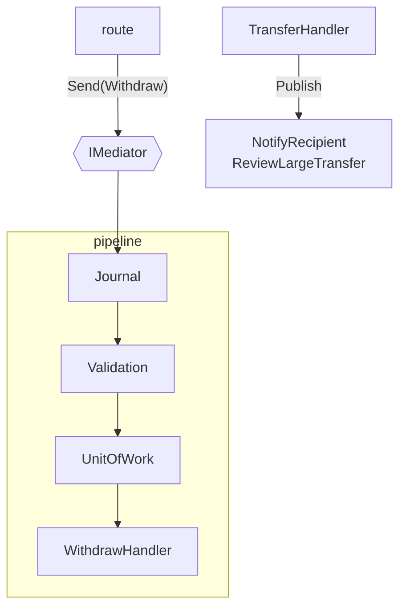

# Fiche 26 · Mediator

> **En une phrase** : on n'appelle plus le code qui sert, on **envoie un message** à un médiateur, qui trouve son
> handler, l'entoure d'un **pipeline** commun et diffuse les **notifications**.

**Famille** : organisation du code · **Origine** : *Gang of Four* (1994) ; en .NET, MediatR (Jimmy Bogard, 2014) ·
**Démo** : [`26-Mediator`](../../26-Mediator) (port 5126) · 📖 [Page complète](../26-mediator.md) ·
🌐 [English](../en/fiches/26-mediator.md)

## L'essentiel

- **Requête** : un seul handler, une réponse. **Notification** : zéro à N handlers, pas de réponse.
- **Comportements** (*pipeline behaviors*) : journal, validation, transaction… écrits une fois, appliqués à toutes les
  requêtes, dans l'ordre d'enregistrement (le premier est le plus extérieur).
- Handlers **sans** validation ni `SaveChanges` ; requête + validateur + handler dans le même fichier (tranche verticale).
- Notifications **en processus, synchrones, dans la transaction** de l'émetteur : un abonné en panne annule tout.

| ✅ Quand l'utiliser | ❌ Moins adapté si |
|---|---|
| Beaucoup de cas d'utilisation qui partagent validation, transaction, audit, droits | Petite application : un appel direct se lit mieux |
| Avec des tranches verticales | Le vrai besoin est de séparer lectures et écritures (c'est le CQRS) |

**Pièges** : « aller à la définition » mène à `IMediator` ; une requête sans handler **compile** (erreur à
l'exécution : un test d'architecture doit vérifier un handler par requête) ; appels en cascade invisibles ;
**confondu avec le CQRS** : un médiateur ne sépare pas les modèles ([Mediator ou CQRS ?](../differences/18-mediator-vs-cqrs.md)).

**À retenir** : MediatR est payant en entreprise depuis 2025 ; le cœur tient en une centaine de lignes, et un
décorateur sur une interface de service donne aussi un pipeline.

---
⬅️ [Transaction Script et Active Record](25-transaction-script-active-record.md) · [Index des fiches](README.md) · ➡️ [Résilience](27-resilience.md)
