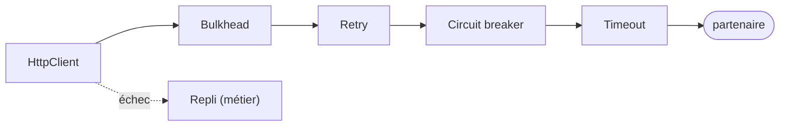

# Fiche 27 · Résilience (timeout, retry, circuit breaker, bulkhead)

**Nom anglais** : Resilience Patterns

> **En une phrase** : ne pas tomber avec un service qu'on ne contrôle pas : couper les appels trop longs, réessayer les
> pannes passagères, arrêter d'appeler un service à terre, borner ce qu'il immobilise, et décider quoi faire sans lui.

**Famille** : découpage du système (ce qui tient un système distribué) · **Origine** : Michael Nygard, *Release It!*
(2007) ; Polly en .NET · **Démo** : [`27-Resilience`](../../27-Resilience) (port 5127) ·
📖 [Page complète](../27-resilience.md) · 🌐 [English](../en/fiches/27-resilience.md)

## L'essentiel

- **Timeout** par tentative ; **retry** des seules pannes passagères (5xx, 408, 429, réseau, timeout), attente qui
  double + jitter, jamais un circuit ouvert.
- **Circuit breaker** : N échecs de suite → ouvert (refus immédiat) → après la pause, **un** appel d'essai. État
  **partagé** (singleton), hors du gestionnaire.
- **Bulkhead** : N appels en cours, M en attente, les autres refusés aussitôt.
- **L'ordre** : bulkhead → retry → breaker → timeout (celui d'`AddStandardResilienceHandler`).
- **Repli** : une décision de métier (ici, ≤ 500 € accepté « non vérifié », sinon 503 + `Retry-After`).

| ✅ Quand l'utiliser | ❌ Attention |
|---|---|
| Tout appel réseau vers un service qu'on ne contrôle pas | Réessayer seulement ce qui est idempotent |
| Microservices, BFF, partenaires, bases distantes | Réglages à tester : il faut simuler les pannes |

**Pièges** : retry sans breaker ni jitter (on achève le service) ; breaker non partagé (ne s'ouvre jamais) ; timeout
autour du retry au lieu de chaque tentative ; corps de requête illisible au 2e essai ; oublier de décider le repli.

**À retenir** : en production, `AddStandardResilienceHandler` (démo 8) ou Polly ; les écrire à la main sert à savoir
ce qu'on règle.

---
⬅️ [Mediator](26-mediator.md) · [Index des fiches](README.md)
