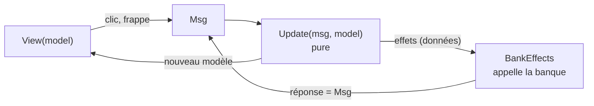

# Fiche 28 · MVU (Model-View-Update)

> **En une phrase** : tout l'état de l'écran dans **un modèle immuable** ; chaque événement est un **message**, traité
> un par un par une fonction **pure** (`Update`) qui rend le modèle suivant et les effets à lancer ; la **vue** est
> recalculée à partir du modèle, et seules les différences atteignent l'écran.

**Famille** : présentation · **Origine** : The Elm Architecture (Evan Czaplicki, 2012) ; Redux (2015) ; en .NET,
Elmish, Fabulous · **Démo** : [`28-Mvu`](../../28-Mvu) (console) · 📖 [Page complète](../28-mvu.md) ·
🌐 [English](../en/fiches/28-mvu.md)

## L'essentiel

- **Un seul état**, immuable (`record` + `with`) : sélection, saisie, attente, question en cours.
- **Les messages** : tout ce qui peut arriver (clics, frappes, **réponses de la banque**), en file, un à la fois.
- **`Update` pure** : pas d'`await`, pas d'appel à la banque ; elle **décrit** les effets (`LoadAccounts`), un
  interpréteur les exécute et renvoie leurs résultats comme messages.
- **Le dérivé est recalculé** (erreurs, bouton actif) : pas de `Validate()` à appeler.
- **La vue** : fonction pure du modèle ; un bouton grisé = un bouton sans message. Diff entre deux vues.

| ✅ Quand l'utiliser | ❌ Moins adapté si |
|---|---|
| Écran riche, à l'historique et à l'ordre des événements importants | Petit formulaire : des liaisons (MVVM) vont plus vite |
| Tout tester sans écran ni serveur, avec des valeurs | Équipe et outillage XAML/liaisons déjà en place |

**Pièges** : un message pour chaque frappe (verbeux) ; un modèle unique qui grossit (le découper) ; recalcul de la vue
sans diff (lent) ; effets lancés depuis `Update` au lieu d'être décrits (on perd la pureté).

**À retenir** : comparer avec [MVC et MVVM](24-mvc-mvvm.md) : même écran, même modèle ; en MVU, la question de
confirmation est un **état**, pas un appel attendu.

---
⬅️ [Résilience](27-resilience.md) · [Index des fiches](README.md)
