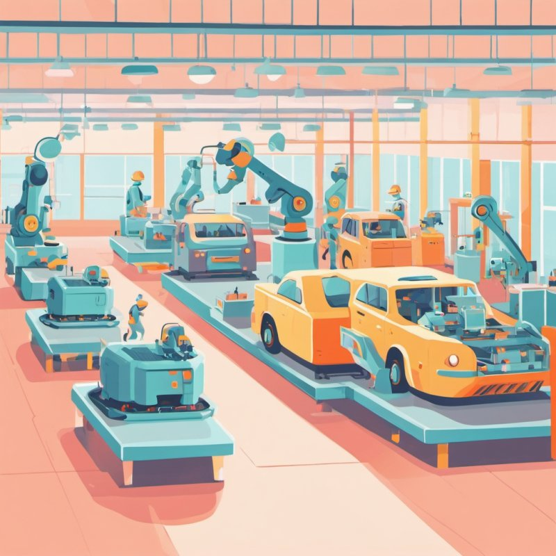

# 20. Le pipeline (« pipes and filters », tuyaux et filtres)

🏠 [Sommaire](README.md) · ⬅️ [L'architecture spatiale](19-space-based.md) · ➡️ [La chorégraphie](21-choregraphie.md) · 🔧 [Version technique](../20-pipeline.md) · 🌐 [English](../en/pour-tous/20-pipeline.md)

> **En une image** : une chaîne de montage. Chaque poste fait une seule chose, toujours la même ; un tapis roulant
> amène les pièces au poste suivant. Tous les postes travaillent en même temps, chacun sur une pièce différente.

---

## L'idée

Certains traitements consistent à faire passer **beaucoup de données** par une suite d'étapes : importer un fichier,
transformer des données, produire des rapports. On les découpe en **filtres** (des postes de travail) reliés par des
**tuyaux** (le tapis roulant).

Chaque filtre :

- ne connaît que ce qui arrive sur son tapis et ce qu'il pose sur le suivant ;
- fait **une seule chose** : lire une ligne, vérifier un numéro de compte, écarter les doublons, convertir une devise…
- écarte ce qui ne va pas, en notant pourquoi.

Les tapis ont une **longueur limitée** : si un poste est lent, les pièces s'accumulent devant lui, et les postes
précédents ralentissent d'eux-mêmes au lieu de déborder.

## Pourquoi c'est bien

- **Chaque étape est simple**, facile à comprendre et à vérifier seule.
- **On recompose à volonté** : ajouter, retirer ou réordonner des postes, ou faire un « essai à blanc » sans le dernier.
- **Tout travaille en même temps** : pendant qu'un poste vérifie la ligne 10, un autre exécute la ligne 9.
- **On repère le goulot** et on double le poste lent.
- **Pas de débordement** : des millions de lignes passent sans remplir la mémoire.

## Ce que ça coûte

- Réservé aux traitements **en flux**, d'étape en étape ; pas fait pour une application interactive.
- **L'ordre compte parfois**, et doubler un poste peut le mélanger : il faut le préserver.
- Si le traitement s'arrête au milieu, il faut pouvoir **reprendre** sans refaire ce qui est déjà fait.

## Quand la choisir

- Pour les **imports, exports, transformations de données**, traitements de nuit, flux continus.
- À l'intérieur d'une application organisée autrement : c'est un outil pour une tâche, pas pour tout.

## Dans notre banque

Une entreprise envoie un fichier de virements. Six postes : lire, vérifier les IBAN, écarter les doublons, convertir les
devises, contrôler la fraude, exécuter. Le fichier d'exemple donne trois virements et huit rejets, chacun avec son
motif. Cent mille lignes passent sans jamais en garder plus de quelques centaines en mémoire. Le contrôle de fraude est
le poste lent ; avec huit copies, l'import va cinq fois plus vite, dans l'ordre du fichier.
