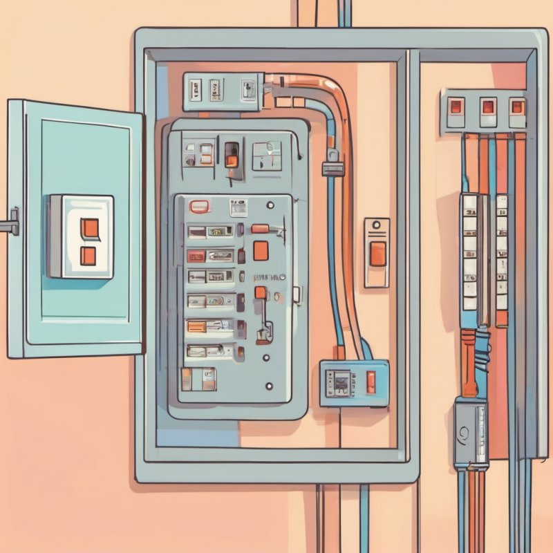

# 27. Résilience (tenir quand un partenaire flanche)

🏠 [Sommaire](README.md) · ⬅️ [Le Mediator](26-mediator.md) · ➡️ [MVU](28-mvu.md) · 🔧 [Version technique](../27-resilience.md) · 🌐 [English](../en/pour-tous/27-resilience.md)

> **En une image** : le **tableau électrique** de la maison. Quand un appareil fait court-circuit, son **disjoncteur**
> saute : ce circuit-là est coupé, mais le reste de la maison garde la lumière, et rien ne prend feu. On le remonte
> une fois l'appareil réparé. Les autres protections suivent la même idée : un **compartiment** qui prend l'eau sans
> couler tout le navire, un **plan B** quand l'appareil est en panne.

---

## L'idée

Notre banque demande l'avis d'un **partenaire extérieur** avant chaque virement : un service qui repère la fraude. Ce
service n'est pas à nous. Il peut être lent, tomber en panne quelques secondes, ou pendant une heure. La question
n'est pas de l'empêcher (on ne peut pas), mais de **ne pas tomber avec lui**. Cinq protections, empilées :

- **Le délai d'attente** : on ne reste pas pendu au téléphone ; au bout d'une seconde sans réponse, on raccroche.
- **Le rappel** : une panne passagère se règle souvent toute seule ; on rappelle, en attendant un peu plus à chaque fois
  (et pas tous à la même seconde).
- **Le disjoncteur** : après cinq échecs de suite, on **arrête d'appeler** pendant trente secondes. Le partenaire
  souffle, et nos clients ont une réponse tout de suite au lieu d'attendre pour rien. Puis on réessaie **une seule** fois
  pour voir s'il va mieux.
- **Les compartiments** : jamais plus de deux appels en cours vers ce partenaire, deux en attente, les autres refusés
  aussitôt. S'il devient très lent, il n'immobilise que ce compartiment ; le reste de la banque continue.
- **Le plan B** : quand on n'a pas d'avis, c'est une **décision métier**. Un petit virement passe quand même, marqué
  « non vérifié », pour être contrôlé plus tard ; un gros attend que le partenaire revienne.

## Pourquoi c'est bien

- Une panne chez le partenaire reste **chez lui** : elle ne fait pas tomber la banque par effet domino.
- Les clients ont une réponse rapide, même mauvaise, au lieu d'un écran qui tourne.
- Le partenaire en difficulté n'est pas **achevé** par une avalanche de rappels.

## Ce que ça coûte

- Des réglages à choisir (combien de rappels, quel délai, quel seuil) et à **tester**, ce qui demande de simuler les pannes.
- Rappeler n'est sans danger que pour une demande qu'on peut **répéter** : demander un avis, oui ; payer, non.
- Le plan B est un **choix métier** : quelqu'un doit décider ce qu'on accepte sans vérification.

## Quand la choisir

Dès qu'une application **dépend d'un service qu'elle ne contrôle pas** à travers le réseau : un partenaire, un autre
service de l'entreprise, une base distante. C'est-à-dire presque toujours.

## Dans notre banque

Le partenaire simulé peut être mis en panne à la demande. En bonne santé, un appel suffit. Capricieux, les rappels
rattrapent ses deux échecs sans que le client le voie. Très lent, chaque appel est coupé au bout d'une seconde et un
petit virement passe « non vérifié ». En panne, le disjoncteur s'ouvre et le partenaire n'est plus appelé du tout ;
trente secondes après son retour, un appel d'essai referme le circuit.
