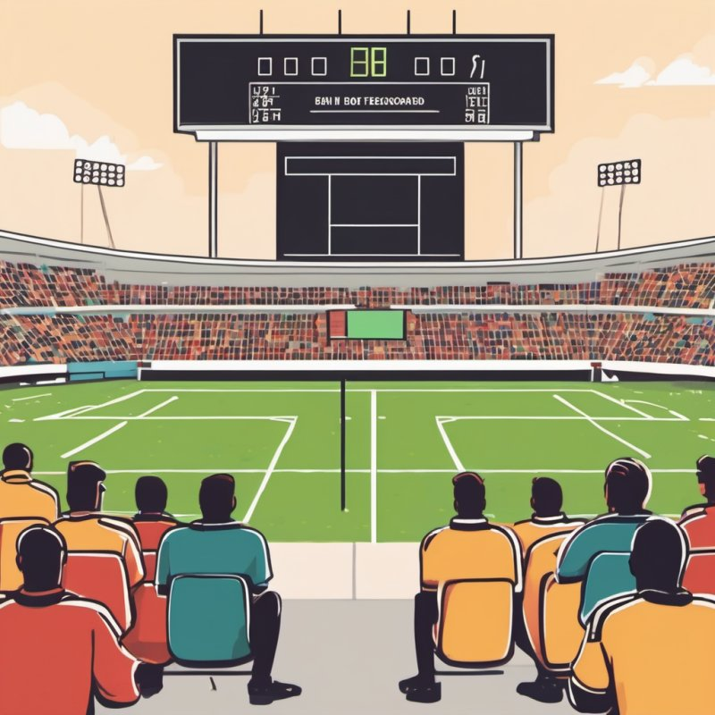

# 28. MVU (l'écran qui se redessine)

🏠 [Sommaire](README.md) · ⬅️ [La résilience](27-resilience.md) · 🔧 [Version technique](../28-mvu.md) · 🌐 [English](../en/pour-tous/28-mvu.md)

> **En une image** : le **tableau d'affichage** d'un match. Personne n'écrit dessus à la main. À chaque événement (un
> but, une faute), l'arbitre note sur sa feuille le **nouvel état** du match, un événement à la fois, et le tableau est
> réaffiché d'après cette feuille. Le tableau ne fait que montrer la feuille.

---

## L'idée

La [page 24](24-mvc-mvvm.md) montrait deux façons d'organiser un écran : le courrier (MVC) et le tableau de bord qui
bouge en direct (MVVM). Voici la troisième, venue du langage **Elm** et popularisée par **React** et **Redux** :
**MVU**, pour Modèle, Vue, Mise à jour.

- **Le modèle** : tout ce que l'écran sait, réuni sur **une seule feuille** : le compte choisi, le montant tapé, le
  virement en cours, la question en attente. On ne raye jamais rien : chaque changement donne une **nouvelle feuille**.
- **Les messages** : tout ce qui peut arriver, écrit noir sur blanc : « l'utilisateur a tapé 250 », « la banque a
  répondu ». Ils font la queue et sont traités **un par un**.
- **La mise à jour** : une règle qui, d'une feuille et d'un message, fait la feuille suivante. Elle ne fait rien d'autre :
  quand il faut appeler la banque, elle l'**écrit** (« demander les comptes »), et quelqu'un d'autre le fait.
- **La vue** : redessinée entièrement à partir de la feuille, à chaque fois. Seul ce qui a changé est vraiment
  modifié à l'écran.

## Pourquoi c'est bien

- **Tout est au même endroit** : pour savoir ce que fait l'écran, on lit la liste des messages et la règle de mise à
  jour. Rien ne se passe en cachette.
- **Facile à vérifier** : on donne une feuille et un message, on regarde la feuille obtenue. Pas besoin de banque, ni
  d'écran, ni d'attendre.
- **Pas de surprise** : un message à la fois, donc jamais deux changements qui se marchent dessus ; une réponse arrivée
  en retard pour un compte qu'on a quitté est simplement ignorée.

## Ce que ça coûte

- **Tout passe par des messages**, même le plus petit changement : c'est plus long à écrire qu'une simple liaison.
- **La vue est recalculée en entier** à chaque fois ; il faut un mécanisme qui ne modifie que ce qui a changé.
- Une seule grande feuille pour un très gros écran devient lourde ; on la découpe alors en morceaux.

## Quand la choisir

- Pour un écran **riche en interactions**, où il faut savoir exactement ce qui s'est passé et dans quel ordre.
- Quand on veut pouvoir **vérifier tout le comportement** sans écran ni serveur.
- C'est le fonctionnement de beaucoup d'applications web modernes (React avec Redux, Elm) et de certaines applications
  .NET (Fabulous, Elmish).

## Dans notre banque

Le même écran que dans la page 24, avec la même banque derrière. Chaque frappe, chaque clic et chaque réponse de la
banque est un message. Un retrait trop gros est signalé dès qu'on le tape, le bouton reste grisé, et à partir de
1 000 € une question s'affiche : elle fait simplement partie de la feuille, en attendant la réponse « oui » ou « non ».
