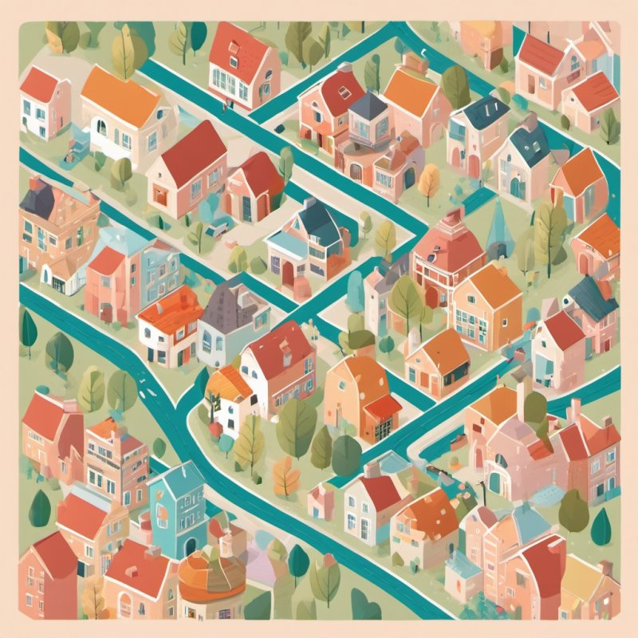

# Les architectures logicielles, expliquées à tout le monde

Pas besoin de savoir programmer pour lire ces pages. Elles expliquent avec des mots simples, et des images de la vie de
tous les jours, les **25 façons d'organiser une application** présentées dans ce dépôt. Pour le détail technique (code,
schémas, tests), chaque page renvoie à sa version pour développeurs.

📘 Les mots un peu techniques sont expliqués dans le [petit lexique](lexique.md).

---

## Une application, c'est comme un bâtiment

Une application, c'est un ensemble de règles (ici : celles d'une petite banque), des données à garder (les comptes, les
soldes) et des écrans pour que les gens s'en servent. Tout cela peut être rangé de mille façons, comme on peut organiser
une maison, un restaurant ou une usine.

Aucune façon n'est « la meilleure ». Chacune règle un problème précis, et en crée parfois un autre. Le bon choix dépend de
la taille du projet, du nombre de personnes qui y travaillent, du nombre d'utilisateurs, et de ce qui coûte le plus cher
quand ça casse.

Pour comparer, **toutes les démos font la même chose** : une petite banque où **Alice vire 250 € à Bob**. Seule la façon
de ranger change.

---

## Six questions différentes

Ces architectures ne répondent pas toutes à la même question. On peut les combiner, une par question.

### ① Comment ranger le code à l'intérieur d'une application ?

*Comme on organise les pièces d'une maison.*

| # | Nom | En une image |
|---|---|---|
| 0 | [Les couches](00-couches.md) | Un restaurant : la salle, la cuisine, la réserve, chacun à son étage |
| 1 | [L'hexagonale](01-hexagonale.md) | Un ordinateur portable et ses prises : on branche ce qu'on veut autour |
| 2 | [L'oignon](02-onion.md) | Un oignon : le plus précieux au centre, protégé par des couches |
| 3 | [La « Clean Architecture »](03-clean.md) | Une mairie : un guichet par démarche |
| 4 | [Le cœur fonctionnel](04-coeur-fonctionnel.md) | Le juge qui décide sur dossier, l'huissier qui va sur le terrain |
| 5 | [Les tranches verticales](05-vertical-slice.md) | Un livre de recettes : tout ce qu'il faut pour un plat sur la même fiche |
| 13 | [Le micro-noyau](13-microkernel.md) | Une perceuse et ses embouts interchangeables |
| 20 | [Le pipeline](20-pipeline.md) | Une chaîne de montage |

### ② Comment découper un grand système en morceaux ?

*Comme on organise une entreprise : un bâtiment ou plusieurs, des services, des responsables.*

| # | Nom | En une image |
|---|---|---|
| 6 | [Les composants](06-composants.md) | Les services d'une entreprise, avec chacun son accueil |
| 7 | [Le monolithe modulaire](07-monolithe-modulaire.md) | Un centre commercial : des boutiques indépendantes sous un même toit |
| 8 | [Les microservices](08-microservices.md) | Un village de petites boutiques, chacune dans sa maison |
| 12 | [Le « serverless »](12-serverless.md) | Le taxi plutôt que la voiture : on paie à la course |
| 14 | [La saga orchestrée](14-saga-orchestree.md) | Un organisateur de mariage qui appelle chaque prestataire |
| 15 | [Le multi-locataire](15-multi-tenant.md) | Un immeuble : un seul bâtiment, un appartement fermé à clé par client |
| 16 | [Le « Backend for Frontend »](16-bff.md) | Un interprète différent pour chaque visiteur |
| 17 | [Les cellules](17-cell-based.md) | Des serres identiques : une vitre cassée n'en gèle qu'une |
| 18 | [Les acteurs](18-modele-acteurs.md) | Des guichetiers qui ont chacun leur boîte aux lettres |
| 19 | [L'architecture spatiale](19-space-based.md) | Des caisses de supermarché qu'on ouvre quand la foule arrive |
| 21 | [La chorégraphie](21-choregraphie.md) | Des danseurs qui se coordonnent sans chef d'orchestre |

### ③ Comment représenter les règles et les données ?

| # | Nom | En une image |
|---|---|---|
| 9 | [CQRS](09-cqrs.md) | La cuisine d'un côté, l'ardoise du jour de l'autre |
| 10 | [L'« Event Sourcing »](10-event-sourcing.md) | Le carnet de comptes : on note chaque opération, jamais seulement le total |
| 11 | [Le « Domain-Driven Design »](11-ddd.md) | Un architecte qui apprend la langue des habitants avant de dessiner |

### ④ Comment remplacer un vieux système sans tout arrêter ?

| # | Nom | En une image |
|---|---|---|
| 22 | [Le figuier étrangleur](22-strangler-fig.md) | Rénover sa maison pièce par pièce, en continuant d'y habiter |

### ⑤ Comment les autres applications parlent-elles au système ?

| # | Nom | En une image |
|---|---|---|
| 23 | [REST, gRPC, GraphQL](23-rest-grpc-graphql.md) | Trois façons de passer commande : à la carte, sur un bon codé, ou en cochant une liste |

### ⑥ Comment organiser l'écran que voit l'utilisateur ?

| # | Nom | En une image |
|---|---|---|
| 24 | [MVC et MVVM](24-mvc-mvvm.md) | Le courrier qu'on envoie et qu'on reçoit, ou le tableau de bord qui bouge en direct |

---

## Par où commencer ?

1. [Les couches](00-couches.md) : la façon classique, celle dont toutes les autres essaient de corriger un défaut.
2. [L'hexagonale](01-hexagonale.md) : la grande idée qui suit, protéger les règles de tout le reste.
3. [Le monolithe modulaire](07-monolithe-modulaire.md) puis [les microservices](08-microservices.md) : le choix le plus
   discuté aujourd'hui, un bâtiment ou plusieurs.
4. Ensuite, au choix, selon ce qui vous intrigue.

Et si vous ne deviez retenir qu'une phrase : **on commence simple, et on ne complique que lorsqu'un vrai problème
l'exige.** Chaque architecture plus élaborée se paie, en temps, en argent et en complexité.

🔧 La documentation technique complète : [Docs](../README.md).
